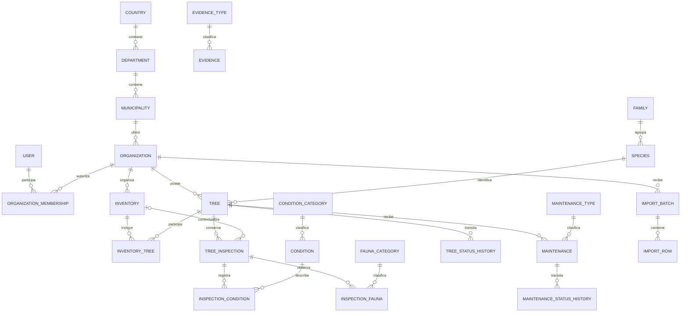

# Modelo de datos de SYSFOREST

## Alcance del diseño

Este es el modelo conceptual objetivo para las fases posteriores a la infraestructura. **La Fase 2 no implementa las tablas de dominio de este documento.** Las migraciones efectivamente disponibles deben consultarse en `database/migrations`; la presencia de una entidad en este diseño no implica que ya exista en la base.

Se utiliza PostgreSQL con PostGIS, una única base y un esquema compartido. Los modelos principales disponen de UUID interno; el código visible de un árbol es un identificador funcional diferente. Los catálogos forestales nacionales se comparten y los registros operativos pertenecen a una organización.

## ERD conceptual principal

El diagrama expresa cardinalidades y responsabilidades. Los nombres físicos y detalles de columnas se concretarán con las migraciones de la fase correspondiente, conservando estas relaciones.

`inventory_trees` representa la participación de un individuo en campañas sin cambiar su identidad ni su organización propietaria. Una inspección siempre corresponde a un árbol y puede indicar una campaña de la misma organización. Las evidencias se vinculan a su árbol, inspección o mantenimiento con integridad explícita; su vínculo concreto se documentará al implementar la fase de evidencias.

## Entidades por responsabilidad

| Grupo | Entidades previstas | Relación o regla principal |
| --- | --- | --- |
| Territorio | countries, departments, municipalities | Jerarquía país → departamento → municipio; geometría de límites cuando exista información oficial. |
| Tenant | organizations, organization_memberships | Municipio obligatorio; membresía única por usuario y organización. |
| Acceso | users, roles, permissions, role_permissions, asignaciones de rol con alcance | Roles globales, departamentales u organizacionales; el alcance autorizado no se deriva de un ID arbitrario del cliente. |
| Autenticación | jwt_refresh_tokens y tablas necesarias para recuperación/verificación | Revocación, expiración, rotación y detección de reutilización de refresh token. |
| Campañas | inventories, inventory_tree | Una organización puede tener varias campañas; un individuo puede participar en varias. |
| Identidad forestal | trees, species, families | Identidad permanente y taxonomía normalizada; código humano único por organización. |
| Catálogos comunes | origins, growth_habits, placements, maturity_states y catálogos de clases | Semántica nacional administrada por SUPER_ADMIN. |
| Seguimiento | tree_inspections, condition_categories, conditions, inspection_conditions | Mediciones fechadas y condiciones múltiples por categoría/órgano. |
| Fauna | fauna_categories, inspection_fauna | Categoría estructurada y observaciones adicionales. |
| Estados | tree_statuses, tree_status_histories | Estado operativo actual y trazabilidad de transiciones. |
| Evidencias | evidence_types, evidences | Exactamente un tipo por fotografía; metadatos y clasificación de publicación. |
| Intervenciones | maintenance_types, maintenances, maintenance_status_histories | Orden manual, responsable de la organización, programación, resultado y seguimiento. |
| Integridad | deletion_reasons, audit_logs | Anulación recuperable de errores y registro de modificaciones. |
| Intercambio | import_batches, import_rows | Validación, errores por fila, trazabilidad y resultado del lote. |
| Comunicación | notifications | Notificaciones privadas según destinatario y alcance autorizado. |

Las asignaciones de rol deben impedir combinaciones inválidas de alcance: SUPER_ADMIN es global, DEPARTMENT_ADMIN tiene departamento y los roles organizacionales requieren una membresía activa en la organización correspondiente. No basta con una etiqueta de rol sin alcance.

## Tree frente a TreeInspection

| Tree: identidad permanente | TreeInspection: observación temporal |
| --- | --- |
| Organización propietaria y código | Árbol y campaña opcional |
| Geometría y datos de localización | Fecha de inspección y autor |
| Taxonomía, especie, nombre común/científico y familia | CAP, DAP, radio y área basal |
| Hábito, origen y emplazamiento | Fustes/estípites, factor de forma y alturas |
| Estado operativo actual | Volúmenes, copa X/Y y clases |
| Clasificación patrimonial/protegida | Madurez, condiciones físico-mecánicas y fitosanitarias |
| Autor original y versión de concurrencia | Fauna, observaciones y evidencias de la inspección |

Los nombres taxonómicos y la familia se relacionan mediante el catálogo de especies, evitando valores contradictorios entre referencias. La política de correcciones taxonómicas y de conservación de su histórico se documentará antes de implementar esa capacidad. Una modificación de ubicación u otro dato permanente queda auditada.

El autor original no cambia cuando otro funcionario modifica un registro. Una nueva inspección crea historia; no reemplaza las mediciones anteriores. Los reportes actuales deben utilizar una selección determinista de la inspección pertinente; los históricos consideran explícitamente fecha y campaña.

## Condiciones y variables del Excel

La plantilla fuente contiene 94 campos lógicos en A:CP; su dimensión técnica llega a CV por formato adicional. Incluye 23 condiciones físico-mecánicas y 44 fitosanitarias. Deben preservarse todas las variables, incluidas las de flores/frutos y sus fechas/estados, aunque no aparezcan en el HTML.

La categoría identifica el ámbito físico-mecánico o fitosanitario y el órgano evaluado. Cada condición tiene identidad estable dentro de esa categoría. `inspection_conditions` relaciona la inspección con las condiciones observadas. No se generan decenas de columnas booleanas en `tree_inspections`, ni se fusionan condiciones de diferentes órganos por compartir etiqueta.

Las observaciones con datos adicionales, como fecha/estado de floración o fructificación, deben conservar una representación estructurada adecuada a su tipo; no se reducen a un checkbox que pierda información.

Los cálculos confirmados son:

- `DAP_m = CAP_cm / (100 × π)`.
- `radio_m = DAP_m / 2`.
- `área_basal_m2 = π × radio_m²`.
- `volumen_comercial_m3 = área_basal_m2 × altura_comercial_m × factor_forma`.
- `volumen_total_m3 = área_basal_m2 × altura_total_m × factor_forma`.
- Clase diamétrica del ejemplo: `ceil(DAP_m × 100 / 5)`.
- Clase de altura del ejemplo: `ceil(altura_total_m / 10)`.

El servicio de dominio centraliza estos cálculos y el repositorio persiste únicamente resultados recalculados y validados por backend. El número de fustes no introduce por sí mismo un multiplicador de volumen: no existe una regla confirmada que lo autorice. Se definirán la precisión de almacenamiento, los redondeos de presentación y el manejo de nulos/ceros antes de implementar cálculos e importaciones.

Las clases manuales del HTML no coinciden con las fórmulas del Excel. También difieren las etiquetas de madurez. La semántica nacional definitiva debe resolver ese conflicto antes de sembrar o automatizar el catálogo; no se añaden umbrales ajenos a los archivos.

## Integridad territorial y organizacional

Las tablas operativas deben incluir `organization_id` cuando sea necesario para asegurar alcance y referencias entre tenants. La base debe impedir que una inspección, campaña, mantenimiento o evidencia de una organización referencie recursos de otra.

Constraints previstos:

- Claves foráneas reales y políticas de borrado que conserven el historial institucional.
- `organizations.municipality_id` obligatorio.
- Código de árbol único dentro de su organización; el UUID permanece independiente.
- Índice único de membresía por `(organization_id, user_id)`.
- Referencias compuestas `(organization_id, resource_id)` en relaciones operativas que deban garantizar coincidencia de tenant.
- Unicidad de `(inspection_id, condition_id)` y de los códigos nacionales de catálogo.
- Índices por organización, fecha, especie, estado y relaciones usadas en filtros.
- Campos y constraints para concurrencia optimista en entidades críticas.

Los índices y constraints concretos se diseñarán con sus consultas y migraciones. El aislamiento se verifica además con pruebas IDOR: conocer el UUID de un árbol ajeno no autoriza su consulta ni modificación.

## PostGIS

Un mecanismo controlado debe garantizar `CREATE EXTENSION IF NOT EXISTS postgis`. El individuo utiliza `geometry(Point, 4326)` como representación espacial; X es longitud y Y es latitud. Los límites territoriales y futuras capas urbanas admitirán geometrías adecuadas a su naturaleza.

Se crean índices espaciales GiST. Las distancias métricas se resuelven con `geography` o una proyección apropiada; nunca se interpreta un grado de longitud/latitud como un metro. Los repositorios centralizan SQL espacial con parámetros vinculados para bbox, inclusión en polígono, proximidad, radio y agregaciones.

Cuando existan se conservan `coordinate_raw`, `coordinate_format`, `datum`, `accuracy_m`, `gps_brand`, `gps_model` y `captured_at`. Una cadena de coordenadas no reemplaza la geometría.

## Historial, evidencias e importación

Los estados operativos previstos son `active`, `under_observation`, `dead`, `felled`, `transplanted`, `removed` y `replaced`, con etiquetas en español. Patrimonial/protegido es una clasificación adicional. La anulación de errores conserva `deleted_at`, `deleted_by`, motivo y notas; no se expone eliminación definitiva en la interfaz habitual.

Cada evidencia registra al menos tipo obligatorio, disk, path, MIME, tamaño, nombre original, autor, fecha y metadatos pertinentes. Las fotografías privadas no se sirven mediante rutas públicas indiscriminadas. El dominio utiliza Laravel Filesystem para permitir almacenamiento local persistente y migración posterior a S3 compatible.

Los lotes de importación registran organización, autor, archivo, estado y resultado; sus filas preservan errores de validación y trazabilidad. La unidad transaccional y la política de aceptación del lote deben quedar explícitas antes de importar datos. Ningún dato inválido se importa silenciosamente.

La auditoría registra actor, organización, acción, recurso, fecha, valores anteriores/nuevos y contexto técnico apropiado, excluyendo contraseñas y tokens. Se autoriza como información privada y no integra Resources ni exportaciones públicas.
