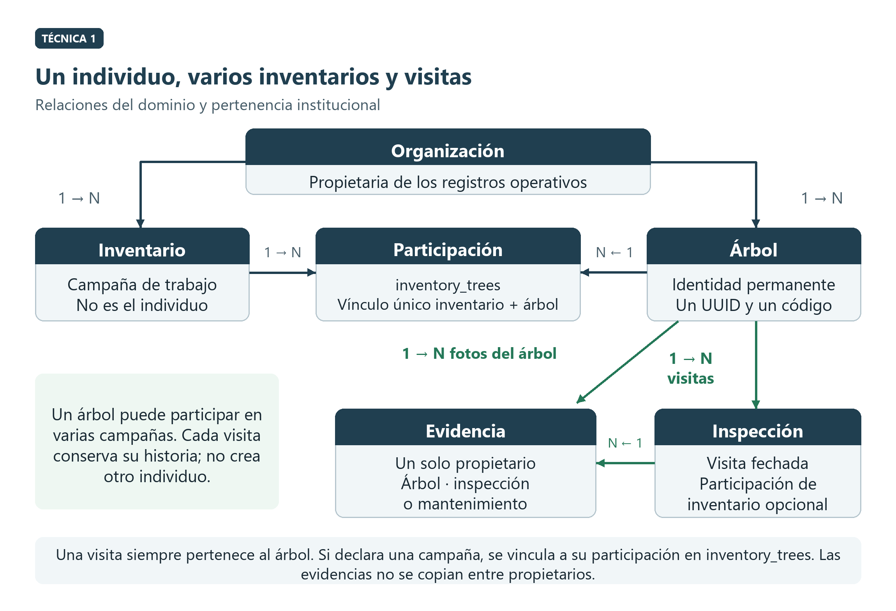
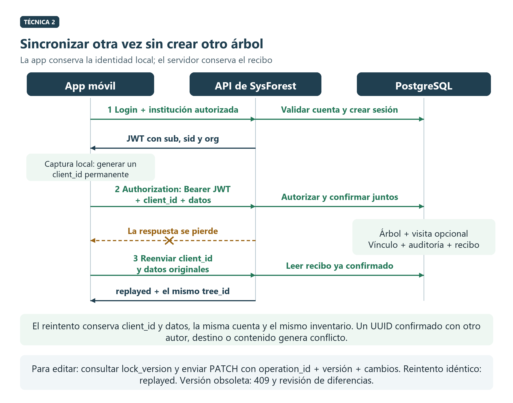
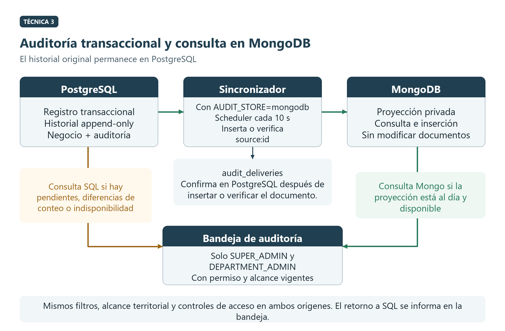

# Manual técnico de SysForest

Este manual permite al equipo de desarrollo y administración comprender la aplicación, preparar su entorno, mantener sus datos e integrar servicios externos. Distingue el entorno local del despliegue de producción, documenta la restauración realizada y señala los servicios que todavía requieren configuración.

Edición ilustrada 1.4 · 4 de noviembre de 2026 · Revisión de acceso móvil y despliegue del 4 de noviembre de 2026

## 1 Alcance y arquitectura de la aplicación

SYSFOREST administra inventarios y seguimiento de arbolado por institución. La aplicación implementada reúne territorio y organizaciones, usuarios y permisos, catálogos nacionales, inventarios, individuos, inspecciones históricas, fotografías, mantenimientos, cartografía, análisis, reportes, importación Excel, portal público, auditoría, prioridad fitosanitaria, carbono aéreo almacenado y API móvil. Este manual describe el código revisado al 4 de noviembre de 2026. Los documentos de fases anteriores son antecedentes: sus cifras de pruebas y declaraciones de alcance no deben interpretarse como una certificación de la versión actual.

El sistema es una aplicación Laravel con renderizado Blade. Nginx recibe HTTP y entrega PHP a PHP-FPM; PostgreSQL con PostGIS conserva los datos de negocio y la geometría; Redis proporciona servicios auxiliares de caché, colas y sesión; queue y scheduler ejecutan procesos independientes. MongoDB sirve como proyección privada de auditoría, mientras PostgreSQL mantiene los registros transaccionales originales. Las librerías JavaScript de interfaz se distribuyen localmente. Los fondos cartográficos sí requieren consultar proveedores externos configurados.

La fuente de trabajo del backend local es /home/josev/SYSFOREST, dentro de Ubuntu 24.04 en WSL. El cliente Flutter se mantiene en /home/josev/SysForest-Mobile, un repositorio independiente situado junto al backend. La instancia de producción se despliega en un VPS separado y utiliza https://sysforest.varcor.tech; el estado y procedimiento se describen en el capítulo 20. El contrato entre ambos se mantiene en docs/mobile-api.md. La distribución en tiendas no forma parte de esta edición.

| Capa | Responsabilidad y límite |
| --- | --- |
| Rutas y middleware | Separan superficies web, móvil y pública; establecen autenticación, límites y contexto antes del caso de uso. |
| Form Request y validación | Comprueban forma, tipos y campos permitidos. El servicio reutiliza las reglas relevantes al recibir llamadas internas. |
| Controller | Coordina una entrada validada, llama al servicio y devuelve Blade, una redirección o una proyección JSON. |
| Service | Aplica reglas del dominio, autorización vigente, transacción y colaboración entre repositorios. |
| Repository | Concentra consultas, persistencia, alcance institucional y SQL espacial parametrizado. |
| Model | Representa relaciones, tipos y persistencia Eloquent. No debe serializarse completo hacia una API pública. |
| Blade y JavaScript | Presentan información preparada e interacción. No consultan la base ni sustituyen las reglas del servidor. |

El flujo obligatorio es Controller → Service → Repository → Model. Los cálculos puros se alojan en clases de dominio y no justifican saltar la capa de persistencia. Un nuevo endpoint debe reutilizar políticas, validadores y servicios existentes antes de introducir reglas paralelas. Las consultas amplias de mapas o reportes son alcances de lectura explícitos; nunca una elevación del contexto de escritura.

## 2 Stack y organización del código

Las siguientes versiones corresponden al archivo composer.lock, al Dockerfile, a las etiquetas de docker-compose.yml y compose.production.yml o a los manifiestos locales SOURCE.json revisados. Una etiqueta de imagen indica la configuración del proyecto, no una verificación del parche que ejecuta cada servidor. Para reproducibilidad, las dependencias PHP se instalan desde composer.lock y las bibliotecas de navegador conservan sus archivos de licencia y procedencia.

| Componente | Versión o referencia | Uso |
| --- | --- | --- |
| PHP / Laravel | PHP 8.4; Laravel 13.31.0 | Aplicación, servicios y vistas Blade. |
| PostgreSQL / PostGIS | Imagen postgis/postgis:17-3.5 | Datos transaccionales y selección espacial. |
| MongoDB | Local 8.0.30-noble; producción 8.0.34-noble | Proyección de lectura de auditoría. |
| Redis / Nginx | 7.4-alpine / 1.28-alpine | Servicios auxiliares y entrada HTTP. |
| JWT | php-open-source-saver/jwt-auth 2.9.3 | Firma y validación criptográfica del access token. |
| MongoDB PHP | Extensión 2.5.3; biblioteca 2.5.0 | Acceso controlado a la proyección de auditoría. |
| Excel / PDF | OpenSpout 5.12.0; Dompdf 3.1.6 | Libros XLSX, lectura de importación y PDF desde Blade. |
| Cartografía | Leaflet 1.9.4; Supercluster 9.1.0; leaflet-heat 0.2.6 | Mapa interactivo, agrupaciones y densidad. |
| Gráficas | Chart.js 4.5.1 | Visualizaciones del tablero de análisis. |
| Interacción | Select2 y jQuery locales | Selectores de catálogo con búsqueda. |

| Ruta del repositorio | Contenido |
| --- | --- |
| app/Http | Controllers, Requests, Resources y middleware; contratos HTTP y proyecciones. |
| app/Services y app/Repositories | Casos de uso, reglas y acceso a datos por dominio. |
| app/Models y app/Policies | Relaciones persistentes y permisos sobre recursos. |
| app/Domain, app/DTOs y app/Validation | Cálculos forestales y espaciales, objetos de selección y validadores compartidos. |
| app/Tenancy y app/Auth | Contexto institucional y objetos de autenticación. |
| resources/views y public/js | Vistas Blade y comportamiento de los módulos. |
| public/vendor | Bibliotecas de navegador locales y sus referencias de origen. |
| routes y config | Superficies HTTP y límites/configuraciones del sistema. |
| database/migrations y database/seeders | Evolución del esquema y referencias autorizadas. |
| docker, Dockerfile y docker-compose.yml | Servicios, runtime, configuración y separación de procesos. |
| docs y bin/check | Contratos por dominio e inspección estática del checkout. |

No se versionan .env, secretos, vendor ni contenido operativo de almacenamiento. Los identificadores de código se mantienen en inglés; documentación, comentarios útiles y PHPDoc se redactan en español. Al revisar una capacidad, deben contrastarse primero rutas, validadores, servicios, repositorios y migraciones; después se actualiza la guía del dominio. El nombre de una fase o una pantalla histórica no acredita una capacidad actualmente desplegada.

## 3 Modelo de datos y reglas forestales

La organización es propietaria de la información operativa y pertenece a un municipio, que pertenece a un departamento y país. Los usuarios pueden tener varias membresías institucionales. Los catálogos forestales son nacionales: no contienen organization_id y no se duplican por institución. La mayor parte de entidades del dominio usa UUID; las cuentas conservan un identificador BIGINT. El código visible del árbol es diferente de su UUID y del número legado.

| Entidad o relación | Semántica que debe conservarse |
| --- | --- |
| Tree | Individuo permanente: propietario, código, especie, ubicación, características y estado actual. |
| Inventory | Campaña institucional. Para nuevas inclusiones exige active=true y status=active. |
| inventory_trees | Participación muchos a muchos: el mismo árbol puede estar en varias campañas de su institución sin duplicarse. |
| TreeInspection | Visita histórica: fecha, mediciones, condiciones, fenología, fauna y observaciones. Puede tener contexto de campaña. |
| Species y SpeciesCommonName | Una especie pertenece a una familia y admite varios nombres comunes, con un máximo de un principal. |
| Evidence | Fotografía con propietario explícito: árbol, inspección o mantenimiento, sin copiarla entre propietarios. |
| Maintenance | Orden manual de intervención, con responsable, fechas, estado e historial propios. |
| ImportBatch e ImportRow | Archivo identificado por huella, vista previa, validación y resultado auditable por fila. |
| Recibos móviles | Confirmaciones durables de altas, mutaciones y fotografías para resolver reintentos sin repetir operaciones. |
| RiskMethodology y RiskEvaluation | Metodologías institucionales versionadas y evaluaciones inmutables por visita y versión, separando sugerencia y confirmación. |
| CarbonProfile y CarbonEstimate | Referencias institucionales por especie e instantáneas de cálculo con entradas, fuentes y versión del algoritmo. |

Tree no contiene inventory_id, family_id ni copias de los nombres de la especie. La familia y el nombre científico se obtienen desde Species; los nombres comunes desde su relación commonNames. external_number conserva el identificador anterior, puede estar vacío y no sustituye la identidad automática. Especie, emplazamiento, orígenes y geometría admiten ausencia cuando no se conocen; el sistema no inventa información para completar una captura.

La generación del código utiliza una secuencia institucional transaccional con UPSERT y RETURNING, no MAX+1. Una anulación no libera el código. Las claves foráneas compuestas relacionan organización, árbol, inventario y participación, impidiendo cruces institucionales incluso si se intenta una escritura SQL directa. created_by identifica al autor original y permanece inmutable; updated_by identifica al último editor autorizado.

El estado técnico active se muestra como Sano. Los demás valores son under_observation, dead, felled, transplanted, removed y replaced. El estado del individuo se distingue de la anulación administrativa: muerto o talado no significa deleted_at. La anulación exige motivo y conserva historia; la restauración recupera la misma identidad. No existe una operación normal de eliminación física del árbol. Los historiales de estado y ubicación mantienen su trazabilidad mediante registros append-only.

Una intervención no modifica automáticamente el estado o las coordenadas del árbol. Una inspección con hallazgos tampoco reclasifica current_status por sí sola. El origen de establecimiento y el origen biogeográfico son dimensiones independientes. Registrar Plantada no demuestra que la especie sea exótica; registrar Nativa no determina si fue plantada. Estas distinciones deben mantenerse en futuras integraciones y reportes.

### Mediciones y cálculos versionados

Las medidas observadas pertenecen a la inspección. Las entradas decimales se transportan como cadenas con punto y hasta seis decimales para evitar pérdidas por coma flotante. Se distingue NULL de cero. CAP y altura total deben ser positivos si se informan; altura comercial y ejes de copa permiten cero; el factor de forma se admite entre 0.45 y 0.70. La altura comercial no supera la total cuando ambas se conocen.

El servidor aplica BCMath y conserva la versión de cálculo. DAP en metros = CAP en centímetros / 100 / PI; radio = DAP / 2; área basal = PI × radio². Los volúmenes usan área basal × altura correspondiente × factor de forma. No se multiplican automáticamente por número de fustes. Las clases de EXCEL_V1 corresponden a ceil(DAP_cm / 5) y ceil(altura_total_m / 10), sin redondear primero el valor presentado. Cambiar fórmulas, precisión o bandas requiere una versión nueva; no recalcular historia silenciosamente.

### Prioridad de gestión fitosanitaria

PhytosanitaryRisk calcula una prioridad ordinal con condiciones y metodología de la organización. RiskEvaluationService registra resultado automático, metodología, origen, decisión y autor de confirmación. Los orígenes históricos, importación y móvil no atribuyen una confirmación profesional inexistente. El servidor rechaza contradicciones en capturas y correcciones ordinarias; las evaluaciones incompletas deben ser explícitas para que ausencia de captura no se interprete como salud.

Web exige una decisión profesional y confirmación en cada alta o corrección; una decisión distinta de la sugerencia requiere observaciones. Las matrices institucionales se validan para evitar progresiones incoherentes. Publicar una metodología crea una versión y no cambia resultados históricos. El cálculo no modifica Tree.current_status ni crea mantenimientos.

### Carbono aéreo almacenado

TreeCarbon estima biomasa aérea mediante Chave 2014, ecuación 4, a partir de densidad básica, DAP en centímetros y altura total en metros. Conserva el método, referencia y entradas; aplica fracción de carbono 0,47 y la conversión a CO₂ por 44/12. Los resultados en kg describen un stock, no emisiones, captura anual o compensaciones. Las fuentes y límites científicos completos están en docs/carbon-estimation.md.

Se requiere hábito Árbol, un fuste, especie identificada, medidas válidas y referencia aplicable. Los estados pendientes conservan valores numéricos nulos. No se extrapola a palmas, arbustos o multifustes ni se completan valores observados. validation_status y source_package distinguen referencias bibliográficas precargadas, revisión profesional y pendientes.

Los perfiles y estimaciones son append-only. La clave de entradas incluye mediciones, referencia y versión del algoritmo; SQL garantiza idempotencia. La lectura requiere compatibilidad con versión de la visita, especie y hábito actuales. La agregación selecciona una última inspección determinista y solo suma estados vivos incluidos. Cambiar especie o hábito recalcula las visitas del individuo sin reescribir instantáneas anteriores.

Cambiar únicamente publicación exige conservar la vigencia de ambos derivados sin alterar autor ni fecha de la decisión profesional. La nueva lock_version no debe hacer desaparecer los cálculos de mapas o reportes. Un cambio real de mediciones o condiciones sigue el flujo de corrección y genera su propia evaluación.

RiskCoverage distingue complete, partial y missing respecto de las condiciones capturadas que la metodología considera. No es una certificación de evaluación de todos los órganos. Sin condiciones evaluadas se conservan sugerencia, severidad y extensión nulas; la confirmación web requiere justificación. Las condiciones registradas excluidas del cálculo se muestran como no puntuadas.

### Lectura del diagrama



Identidad del árbol, participación en inventarios y visitas históricas

La relación inventory_trees permite incorporar el mismo individuo a varias campañas de su organización. Las inspecciones pertenecen al árbol y pueden indicar una participación de campaña. Cada fotografía conserva un único propietario: árbol, inspección o mantenimiento.


## 4 Instalación local y componentes de ejecución

El entorno revisado utiliza Docker Compose dentro de Ubuntu-24.04 sobre WSL. La fuente de trabajo es /home/josev/SYSFOREST. Los comandos de este capítulo se ejecutan desde una terminal Ubuntu en esa carpeta; no desde una copia de preparación en Windows. Esta configuración corresponde al piloto local. El despliegue de producción utiliza el procedimiento separado del capítulo 20; esta configuración local no proporciona alta disponibilidad.

Se necesitan Docker y Docker Compose accesibles para el usuario de Ubuntu, Bash y OpenSSL para preparar la configuración. PHP y Composer funcionan en contenedores y no requieren instalación en Windows ni en Ubuntu. Para ejecutar la comprobación completa bin/check se necesitan además Node y flock en Ubuntu. Los archivos y las fotografías exigen almacenamiento persistente; el dimensionamiento de CPU, memoria y disco deberá medirse con el volumen y la concurrencia previstos.

Las referencias anteriores provienen del Dockerfile, Compose y composer.lock revisados. Una etiqueta de imagen no identifica por sí sola todos sus bytes: para una liberación controlada también debe registrarse el identificador o digest de las imágenes realmente construidas y utilizadas.

### Primera preparación

```
cd /home/josev/SYSFOREST
docker version
docker compose version
bash bin/setup-env
docker compose config --quiet
docker compose build
docker compose up -d
docker compose ps -a
curl --fail --silent --show-error http://localhost:8080/health/ready
```

bin/setup-env crea .env desde .env.example cuando falta, genera claves locales y conserva la configuración existente. No imprime sus valores. La imagen instala las versiones fijadas en composer.lock y mantiene herramientas de desarrollo. db-init prepara roles, bases, PostGIS y privilegios; init ejecuta migraciones incrementales. Los dos inicializadores deben terminar con código cero. Los ocho servicios continuos son postgres, mongodb, redis, mailpit, app, queue, scheduler y nginx.

La preparación de datos iniciales es una operación separada y deliberada. El arranque no ejecuta seeders. En una instalación nueva destinada específicamente a reproducir el piloto autorizado puede utilizarse DatabaseSeeder después de preparar y verificar el paquete privado de Ornato descrito en docs/restrepo-ornato-seed.md.

```
docker compose exec -T app php artisan db:seed --class=DatabaseSeeder
```

Este comando no es un diagnóstico ni un paso de cada arranque. Sincroniza catálogos, permisos e instituciones del piloto. En local también prepara cuentas y carga Restrepo: requiere archivos privados con huellas conocidas, no incluidos en Git ni en la imagen, y ejecuta el restablecimiento de contraseñas de desarrollo. Puede revocar sesiones existentes. No debe utilizarse como aprovisionamiento de producción, ni modificarse para importar registros ficticios o eludir huellas de cargas confirmadas. En un entorno ya preparado basta docker compose up -d.

## 5 Configuración secretos y persistencia

La referencia compartible es .env.example. El archivo .env real y el directorio docker/secrets quedan fuera del repositorio y del contexto de construcción. No deben incorporarse a documentos, incidencias, capturas ni adjuntos. Para validar Compose sin mostrar credenciales se utiliza docker compose config --quiet; la salida completa de config puede resolver valores sensibles.

- Identidad y URL: APP_ENV, APP_KEY, APP_DEBUG, APP_URL, JWT_SECRET, JWT_ISSUER, JWT_AUDIENCE, JWT_MOBILE_AUDIENCE, JWT_TTL y AUTH_SESSION_TTL_MINUTES. APP_KEY y JWT_SECRET son secretos distintos. JWT_ISSUER y JWT_MOBILE_AUDIENCE son opciones admitidas en config/security.php aunque no aparezcan como líneas activas en .env.example.
- PostgreSQL: DB_DATABASE, DB_TEST_DATABASE, DB_USERNAME, DB_PASSWORD, DB_MIGRATOR_USERNAME, DB_MIGRATOR_PASSWORD, POSTGRES_USER y POSTGRES_PASSWORD. Las bases operativa y auxiliar deben tener nombres diferentes.
- MongoDB: AUDIT_STORE, AUDIT_MONGO_URI, AUDIT_MONGO_DATABASE, AUDIT_MONGO_COLLECTION, AUDIT_MONGO_USERNAME, AUDIT_MONGO_PASSWORD, MONGO_ROOT_USERNAME y MONGO_ROOT_PASSWORD. AUDIT_MONGO_AUTH_SOURCE y AUDIT_BATCH_SIZE son opciones adicionales reconocidas en config/audit.php.
- Sesiones, cola y caché: SESSION_DRIVER, SESSION_ENCRYPT, SESSION_SECURE_COOKIE, SESSION_SAME_SITE, REDIS_QUEUE_RETRY_AFTER y las variables REDIS_* y CACHE_*. Compose fija los servicios internos Redis y PostgreSQL para los procesos PHP.
- Políticas de archivos y correo: EVIDENCE_*, IMPORTS_*, REPORTS_*, FILESYSTEM_DISK, MAIL_* y LOG_*. Los límites efectivos también dependen de config/*.php, PHP y Nginx.

setup-env solo genera JWT_SECRET automáticamente cuando detecta APP_ENV=local. No sustituye una gestión de secretos de producción ni rota claves ya existentes. Cambiar una contraseña en .env no cambia la contraseña de un usuario ya creado en PostgreSQL o MongoDB; toda rotación exige actualizar el servidor y sus consumidores de forma coordinada. Debe conservarse APP_KEY para recuperar datos cifrados y planificarse el efecto de rotar claves JWT sobre las sesiones.

Los procesos app, queue y scheduler usan el rol PostgreSQL de ejecución, sin facultades para modificar el esquema. El inicializador init recibe el secreto migrador y db-init la credencial administrativa que necesita. Compose elimina las credenciales administrativas heredadas del entorno PHP. En MongoDB, la aplicación solo puede consultar e insertar en la colección de auditoría; la credencial administrativa se reserva al servicio de base de datos.

La publicación local se limita a Nginx en 127.0.0.1:8080, configurable con APP_PORT, y Mailpit en 127.0.0.1:8025. PostgreSQL, MongoDB, Redis, PHP-FPM y SMTP permanecen en la red de Compose. Mailpit contiene enlaces de invitación, verificación y recuperación que permiten realizar acciones: su buzón debe mantenerse privado.

Los volúmenes lógicos son postgres_data, mongo_data, redis_data, storage_data y mailpit_data, con el prefijo del proyecto Compose. storage_data contiene archivos privados, derivados y temporales. Los servicios PHP comparten ese volumen y montan el código como solo lectura; Nginx solo recibe public. Las evidencias originales no se publican mediante storage:link ni public/uploads. Deben conservarse las rutas y los permisos, sin recurrir a permisos universales de escritura.

## 6 Aislamiento institucional y autorización

SYSFOREST usa una base compartida con organization_id como clave de aislamiento. TenantContext no toma como autoridad el organization_id recibido libremente de una pantalla: la selección debe derivarse de una membresía o de un alcance administrativo vigente. Los repositorios institucionales reciben explícitamente la organización autorizada. Un UUID conocido de otra institución no autoriza a consultar ni cambiar el registro.

| Perfil | Alcance operativo |
| --- | --- |
| SUPER_ADMIN | Administración nacional y catálogos. Puede consultar alcances amplios; para escribir debe existir un destino institucional explícito. |
| DEPARTMENT_ADMIN | Lectura y consolidación en departamentos asignados. No adquiere escritura forestal por seleccionar una organización. Acceso a auditoría departamental. |
| ORGANIZATION_ADMIN | Administración y operación de las instituciones autorizadas por su membresía; inventarios, usuarios institucionales y restauración conforme a permisos. |
| OFFICIAL | Captura y seguimiento forestal de su institución. La modificación del árbol requiere las condiciones del inventario activo; no administra usuarios ni restaura anulaciones. |
| Público anónimo | Consulta exclusivamente proyecciones publicadas. No se resuelve TenantContext ni se reutiliza un perfil administrativo. |

Los nombres de rol no sustituyen las concesiones RBAC. Middleware, Gates/Policies y servicios comprueban usuario, sesión, cuenta verificada, pertenencia y permiso específico. Los servicios de escritura revalidan dentro de su operación y bloquean referencias pertinentes. La bandeja de auditoría tiene además una restricción nominal: solo SUPER_ADMIN o DEPARTMENT_ADMIN con audit.view. Un administrador institucional o funcionario queda excluido aunque gestione sus árboles.

El dato pertenece a la organización, no exclusivamente al funcionario creador. Otro funcionario autorizado puede trabajar sobre el mismo individuo si se cumplen las reglas del dominio. No existe una asignación móvil exclusiva de inventario por nombre de usuario: el JWT identifica a la persona y a la institución, y el inventario se selecciona entre los devueltos por el servicio. created_by e included_by permiten atribuir la captura al responsable real.

TreeReadScope delimita organización, departamentos, nacional o published. Los mapas y reportes amplios autorizan ese alcance sin ampliar TenantContext. Al abrir una ficha institucional desde el mapa se realiza una selección explícita y protegida de institución; las operaciones posteriores conservan sus políticas habituales. Conjuntos vacíos de instituciones o departamentos no deben interpretarse como acceso total. Las exportaciones revalidan acceso antes de entregar el archivo.

risk.manage y carbon.manage habilitan parámetros institucionales para SUPER_ADMIN y ORGANIZATION_ADMIN. La lectura de resultados respeta inspections.view; los reportes combinan sus permisos propios. Los parámetros institucionales nunca amplían el alcance de escritura ni sustituyen los catálogos nacionales. El portal público excluye prioridad, metodología, carbono y referencias.

## 7 Autenticación web y móvil

El JWT acredita que el access token fue emitido por el servidor. Su firma válida no basta: cada petición autenticada verifica también la sesión revocable en PostgreSQL y el estado vigente de la cuenta. TokenService comprueba firma, tiempo, emisor, audiencia, sujeto y sid; SessionService verifica correspondencia, vencimiento y revocación. Los permisos no se congelan dentro del token.

| Aspecto | Navegador | API móvil |
| --- | --- | --- |
| Credencial de acceso | Cookies HttpOnly sysforest_access y sysforest_refresh. | Authorization: Bearer <access_token>. |
| Contexto | Selección institucional validada y vinculada a la sesión de navegación. | Claims client=mobile y org; la sesión debe coincidir con la organización firmada. |
| Audiencia predeterminada | sysforest-web. | sysforest-mobile. |
| Protección de mutación | CSRF y controles de continuidad/contexto del formulario. | Bearer estricto, JSON o multipart según endpoint y políticas actuales. |
| Renovación | POST coordinado por el navegador; sin exponer tokens a JavaScript. | POST /api/mobile/v1/auth/refresh con refresh_token opaco. |
| Separación | No acepta Authorization como alternativa de autenticación web. | No acepta cookies, query ni cuerpo como alternativa al Bearer. |

La vigencia predeterminada del access es de 10 minutos y la absoluta de sesión/refresh de siete días, configurables en config/security.php. Rotar el refresh no extiende el vencimiento absoluto. Los refresh se almacenan como hash SHA-256, se consumen una vez y generan el siguiente secreto. Reutilizar uno ya consumido revoca la familia: el cliente debe coordinar una sola renovación a la vez. Una respuesta de renovación perdida puede requerir iniciar sesión de nuevo.

En web, las cookies son HttpOnly, SameSite=Lax y Secure fuera del HTTP local; los tokens no deben guardarse en localStorage o sessionStorage. La sesión Laravel conserva CSRF, mensajes y la selección del navegador. GET /auth/session/status consulta la continuidad y POST /auth/session/ensure renueva cuando corresponde. El coordinador conserva formularios abiertos y detecta cambios de cuenta o institución; no reenvía automáticamente una escritura ya enviada.

En móvil, el header transporta el JWT firmado con sub, sid, org, client, audiencia y expiración. No existe en este contrato una firma adicional del cuerpo HTTP: HTTPS protege el transporte completo. El secreto de firma pertenece exclusivamente al backend y nunca se distribuye a la app. La app guarda únicamente tokens en almacenamiento seguro, nunca la contraseña; conserva las colas separadas por servidor, cuenta e institución y no reasigna pendientes al cambiar de identidad.

El acceso móvil empieza en POST /api/mobile/v1/auth/organizations con email y password. El servidor valida credenciales, actividad y verificación antes de devolver las instituciones autorizadas; conserva los alcances institucionales, departamentales y nacionales vigentes. Esta consulta no emite JWT ni crea una sesión web o móvil. Una única institución permite continuar automáticamente; varias exigen selección explícita por nombre. La app llama entonces a /auth/login con el organization_id seleccionado y el servidor revalida el acceso antes de emitir los tokens.

El descubrimiento devuelve 200 con data: [] si las credenciales son válidas pero no hay instituciones disponibles; credenciales incorrectas, cuentas inactivas o correo no verificado producen 401 genérico. La respuesta usa Cache-Control: no-store y el límite identity.login compartido con el inicio de sesión. La contraseña solo permanece en memoria durante este recorrido; cambiar de cuenta borra la lista y la contraseña. El UUID y el código institucional son datos internos de la respuesta, nunca campos que deba completar la persona.

### Configuración de SysForest Mobile

La aplicación Flutter vive en /home/josev/SysForest-Mobile, al lado del backend /home/josev/SYSFOREST. lib/config/app_config.dart concentra la configuración recibida al compilar con --dart-define-from-file. SYSFOREST_API_URL contiene el origen de la plataforma, sin /api/mobile/v1; el cliente añade el prefijo versionado. No se define un UUID institucional fijo en la configuración.

config/production.json configura SYSFOREST_API_URL=https://sysforest.varcor.tech y ALLOW_LOCAL_HTTP=false para SysForest Mobile 0.2.1+3. config.example.json conserva una plantilla HTTPS y config.local.json permite una copia de configuración excluida de Git. El perfil config/development.json apunta a http://127.0.0.1:8080 con HTTP local permitido; un teléfono requiere el túnel de depuración para usar ese perfil. No incluya contraseñas, tokens ni secretos del servidor en estos JSON.

```sh
bash scripts/build_android.sh --dart-define-from-file=config/production.json
```

Cambiar el archivo de configuración exige recompilar e instalar la aplicación. No incluya contraseñas, tokens ni claves del servidor en estos JSON: los valores compilados pueden extraerse del paquete. Una URL ausente o no válida bloquea solicitudes y muestra un aviso de configuración; no impide consultar los datos ya descargados.

Cada cuenta local conserva el servidor con el que se preparó. Si una nueva compilación cambia la URL, la aplicación mantiene sus datos y pendientes, pero impide utilizar esa cuenta contra el nuevo servidor. La reautenticación conserva correo e institución de la cuenta seleccionada; no reasigna operaciones al usuario que introduce otra identidad.

## 8 Contrato general de la API móvil

El prefijo versionado es /api/mobile/v1. Las rutas son privadas y distintas de la API pública o los endpoints JSON de la sesión web. La URL base de producción debe acordarse y publicarse con HTTPS antes de integrar un dispositivo físico. La dirección loopback del piloto solo representa el servicio local del equipo que la ejecuta.

| Método y ruta relativa | Función |
| --- | --- |
| POST /auth/organizations | Valida email y password y lista instituciones autorizadas sin crear sesión ni emitir tokens. |
| POST /auth/login | Recibe email, password y organization_id; devuelve tokens e identidad autorizada. |
| POST /auth/refresh | Rota refresh_token y devuelve un nuevo par de credenciales. |
| POST /auth/logout | Revoca por refresh_token; responde 204 de forma idempotente. |
| GET /auth/me | Consulta persona, institución y sesión autenticadas. |
| GET /inventories | Lista inventarios activos de la institución y capacidades orientativas. |
| GET /parameterizations | Entrega manifiesto de catálogos, estados y paginación. |
| GET /parameterizations/{catalog} | Consulta una colección permitida de referencias activas. |
| POST /inventories/{inventory}/trees/sync | Confirma lotes de capturas nuevas con client_id. |
| GET /inventories/{inventory}/trees | Lista individuos participantes; página de 50 por defecto, máximo 100. |
| GET /trees/{tree} | Devuelve ficha y lock_version vigentes. |
| PATCH /trees/{tree} | Edita identidad usando operation_id, lock_version y changes. |
| GET /trees/{tree}/inspections | Consulta visitas del individuo; página de 50 por defecto, máximo 100. |
| GET /inspections/{inspection} | Obtiene entradas, resultados y versión de una visita. |
| POST /trees/{tree}/inspections | Crea una visita con operation_id, inventory_id e inspection. |
| PATCH /inspections/{inspection} | Corrige una visita con control de versión y recibo durable. |
| POST /trees/{tree}/photos | Carga una fotografía multipart con client_id propio. |
| GET /trees/{tree}/photos | Lista la galería privada paginada. |
| GET /photos/{photo}/content | Entrega los bytes de la fotografía tras autenticar Bearer. |

Los POST y PATCH JSON exigen un objeto como cuerpo y Content-Type: application/json. El máximo general es 1 MiB; fotografías usan un límite y formato separados. Todas las respuestas de esta superficie son privadas y no-store. Las rutas de lectura permiten 90 solicitudes por minuto, los lotes 20 y las escrituras 30 por usuario según el registro de límites actual. Login y refresh reutilizan límites de identidad. Una respuesta 429 requiere esperar; no generar nuevos identificadores para eludirla.

```
GET /api/mobile/v1/auth/me HTTP/1.1
Authorization: Bearer <access_token>
Accept: application/json

POST /api/mobile/v1/auth/refresh HTTP/1.1
Content-Type: application/json

{"refresh_token": "<refresh_token_vigente>"}
```

Los marcadores entre ángulos son valores a obtener del ambiente y de respuestas previas; no son credenciales funcionales. El integrador debe procesar el código HTTP, el estado de cada operación y los errores por campo. Las capacidades de meta orientan la interfaz pero no sustituyen la autorización de cada recurso en el servidor. Un 404 también protege registros fuera del alcance institucional.

### Descarga de parametrizaciones

El registro cerrado contiene 14 colecciones: placements, species, families, growth_habits, establishment_origins, biogeographic_origins, condition_categories, physical_conditions, phytosanitary_conditions, fauna_categories, maturity_states, deletion_reasons, evidence_types y maintenance_types. Los nombres comunes viajan dentro de cada especie en common_names; no existe una colección móvil independiente parameterizations/common_names. Cada nombre incluye id, code, name e is_primary.

Catálogos e inventarios aceptan q, page y per_page, con 100 por defecto y máximo 500. Solo se entregan referencias activas y padres activos. La app debe descargar todas las páginas antes de reemplazar su caché. No hay delta ni token de instantánea entre páginas; updated_at ayuda a informar, pero no constituye un protocolo incremental. Si una referencia deja de estar vigente después de la descarga, el servidor vuelve a validarla al sincronizar.

## 9 Sincronización idempotente de capturas nuevas

La app genera un client_id UUID cuando crea la captura local y lo conserva permanentemente con la cuenta, institución, inventario y contenido pendiente. Pulsar Sincronizar varias veces debe reenviar ese mismo identificador y payload. La protección es compartida: el cliente mantiene la identidad local y el servidor guarda el recibo durable que impide ejecutar dos veces la captura confirmada.

```
POST /api/mobile/v1/inventories/<inventory_uuid>/trees/sync
Authorization: Bearer <access_token>
Content-Type: application/json

{
  "items": [
    {
      "client_id": "2e34fe9a-ffae-4e8f-b56d-f20cb98491e2",
      "tree": {
        "external_number": "1",
        "current_status": "active"
      },
      "inspection": {
        "inspection_date": "2026-10-13",
        "cap_cm": "120.000000",
        "total_height_m": "12.500000"
      }
    }
  ]
}
```

El ejemplo es ilustrativo y no solicita insertar datos de prueba. inspection es opcional; si se envía, requiere fecha. current_status es obligatorio en una alta, y active se presenta como Sano. La especie y otras referencias se incorporan con los UUID obtenidos del catálogo. La ruta determina el inventario y el JWT determina cuenta e institución. No enviar autores, IDs internos de servidor, publicación, versión, family_id ni vínculos calculados, tampoco con null.

Cada lote admite entre 1 y 100 items. La transacción es por captura: árbol, participación, inspección opcional, auditoría y recibo se confirman juntos. Una inspección inválida no deja un árbol parcial. En un lote mixto, los items válidos sí pueden quedar confirmados aunque otros fallen. Por eso HTTP 200 del sobre no significa que todos los individuos se guardaron: revisar summary y results.

| Estado del item | http_status | Acción del cliente |
| --- | --- | --- |
| created | 201 | Guardar IDs/código devueltos y retirar el pendiente. |
| replayed | 200 | Aceptar el recibo original y retirar el pendiente sin otra alta. |
| rejected | 422 | Mostrar errores y corregir la captura no confirmada. |
| conflict | 409 | Conservar la captura y revisar el uso del identificador; no reemplazarlo a ciegas. |
| forbidden | 403 | Conservar pendiente y resolver permisos o identidad con el administrador. |

mobile_tree_receipts tiene unicidad por organización y client_id, y liga autor, inventario, hash canónico y resultado. El orden de claves JSON no altera la comparación; sí lo hacen tipos, valores y orden de listas. Un reenvío idéntico recupera el recibo original. Otro contenido, usuario o inventario bajo el mismo UUID produce idempotency_conflict. El recibo confirmado se puede recuperar aunque después se cierre la campaña; una captura nueva exige campaña activa.

La exclusión concurrente combina bloqueos de actor, organización e inventario con restricciones únicas de PostgreSQL. Si la conexión se pierde después de confirmar algunos items, reenviar todos los pendientes con sus UUID originales permite recuperar lo confirmado. No borrar recibos ni cambiar client_id para resolver un conflicto: eso puede crear un segundo individuo. Tampoco se deduce duplicidad por el número legado, por el nombre común o por cercanía GPS.

### Lectura del diagrama



Recuperación de una captura confirmada cuando se pierde la respuesta

La app reenvía el mismo client_id y contenido con la misma cuenta y destino; el servidor recupera el recibo confirmado y devuelve el mismo tree_id. La captura y su auditoría se confirman juntas. Las ediciones usan operation_id para el reintento y lock_version para detectar cambios concurrentes.


## 10 Ediciones móviles visitas y fotografías

### Edición con concurrencia optimista

Antes de editar, la app consulta la ficha y conserva lock_version. PATCH recibe operation_id UUID para esa operación, la versión esperada y changes. Omitir un campo conserva su valor; null solo vacía atributos que lo permiten. Tree representa la identidad compartida entre inventarios, de modo que su edición no crea una variante de campaña. Mediciones y observaciones se editan en TreeInspection.

```
PATCH /api/mobile/v1/trees/<tree_uuid>
Authorization: Bearer <access_token>
Content-Type: application/json

{
  "operation_id": "d904e542-51a0-4b81-aecf-6192d657bc83",
  "lock_version": 3,
  "changes": {
    "location_description": "Costado oriental del predio"
  }
}
```

El servidor bloquea el recurso, compara la versión y confirma cambio, auditoría y mobile_mutation_receipts en la misma transacción. Un reintento idéntico devuelve replayed y no incrementa otra vez la versión. El resultado del recibo es el snapshot confirmado, que puede ser anterior a una edición posterior: consultar GET antes de preparar la siguiente operación. Los permisos sobre el recurso se revalidan incluso al recuperar un recibo.

Un 409 con version_conflict indica una versión obsoleta. Conservar cambios locales, descargar la ficha vigente, resolver diferencias y preparar una nueva edición con la nueva versión y un nuevo operation_id. Un 409 con idempotency_conflict significa que el UUID ya confirmó otra acción, contenido, autor o destino: revisar la operación original. Los cambios GPS requieren tipo y motivo; no se permite mover la autoría, publicación o participación del árbol mediante este PATCH.

### Nuevas visitas y correcciones

POST /trees/{tree}/inspections recibe operation_id, inventory_id e inspection. El servidor exige una participación existente del árbol en ese inventario autorizado y puede registrar la visita aunque la campaña ya no esté activa, según la política de inspecciones. Devuelve 201 created o 200 replayed. PATCH /inspections/{inspection} corrige entradas mediante operation_id, lock_version y changes; no permite trasladar la visita a otro inventario. Recalcula derivados bajo las reglas originales y conserva revisiones.

### Fotografías privadas

Primero se confirma el árbol y se conserva tree_id. Cada fotografía usa su propio client_id estable y un POST multipart/form-data con file y evidence_type_id; caption, notes y captured_at son opcionales. La biblioteca HTTP debe construir el boundary. No enviar base64 ni incluir archivos dentro del JSON de altas. La fotografía móvil de este contrato pertenece al árbol, no a una inspección o campaña.

Se aceptan JPEG, PNG y WebP tras validar extensión, contenido, decodificación y dimensiones. Los valores predeterminados son 10 MiB por archivo y 20 millones de píxeles; el sobre admite el archivo más 64 KiB. HEIC requiere conversión previa. Conservar exactamente los bytes convertidos y metadatos para reintentar: recomprimir una foto entre intentos cambia su hash. captured_at utiliza ISO 8601 con segundos y zona, por ejemplo 2026-10-13T09:30:00-05:00.

mobile_photo_receipts liga organización, client_id, árbol, autor, SHA-256 del archivo y metadatos normalizados. La primera carga devuelve 201 created; la repetición idéntica, 200 replayed; otro contenido o destino, 409 idempotency_conflict. La galería devuelve content_url relativo y su descarga exige Bearer; no expone rutas internas ni originales públicos. El journal de almacenamiento coordina archivos y confirmación para recuperar fallos sin borrar fotos confirmadas.

Mantener cuatro colas independientes: altas, ediciones, visitas y fotos. Retirar cada pendiente únicamente al recibir created, updated o replayed según su contrato. Una foto fallida no exige crear de nuevo el árbol. Todos los pendientes conservan cuenta e institución originales; el cambio de sesión no debe reasignarlos silenciosamente a otro usuario.

### Derivados de riesgo y carbono en móvil

El móvil captura entradas; las fórmulas y la evaluación definitiva permanecen en el backend. TreeInspectionService se invoca con origen mobile para no exigir ni inventar una confirmación profesional web. Los resultados privados devueltos deben guardarse como datos de solo lectura con su referencia de inspección y versión. Antes de sincronizar pueden faltar; tras una edición offline no deben presentarse como resultado de las nuevas entradas.

La extensión del contrato se documenta en docs/mobile-api.md. Conservar compatibilidad con respuestas antiguas y recibos idempotentes: una respuesta repetida conserva su contenido histórico y no constituye una consulta del estado actual. Para información actualizada, volver a descargar el recurso autorizado. No usar los endpoints web /api/v1 como reemplazo del contrato Bearer móvil.

GET /trees/{tree}/inspections y GET /inspections/{inspection} añaden risk y carbon. risk es null si falta risk.view; el acceso a la visita mantiene inspections.view. POST, PATCH y recibos de operación conservan su proyección anterior: después de confirmar se usa GET para recuperar derivados vigentes. No mutar recibos congelados ni atribuir a la prioridad una confirmación móvil.

## 11 Motor común de filtros y taxonomía

TreeFilterInput valida claves y límites; TreeFilterService construye TreeFilterDTO; TreeQueryRepository compone selección forestal y alcance. MapFilterService añade criterios espaciales y de presentación. Reportes, análisis, mapas y bandejas reutilizan esta lógica para evitar que un mismo filtro cuente conjuntos distintos. El DTO contiene datos validados, no autoridad: siempre necesita un TreeReadScope previamente autorizado.

Nombre científico es un selector buscable que envía species_id. Nombre común envía common_name_id y representa un registro exacto de SpeciesCommonName, principal o secundario. La opción muestra nombre común y científico para distinguir homónimos entre especies. Elegir cualquiera de los nombres de una especie obtiene los mismos individuos. La consulta usa EXISTS, sin joins que multipliquen los árboles o los conteos.

family_id, species_id y common_name_id se combinan con AND. Una combinación incompatible devuelve cero resultados, no ignora un criterio para ampliar la búsqueda. Los cambios interactivos de familia limpian especie y nombre común; un cambio de especie limpia nombre común. Las opciones conservan referencias históricas inactivas para consulta, marcándolas como tales, pero la creación de datos nuevos sigue exigiendo catálogos disponibles.

Las claves de texto common_name y scientific_name permanecen por compatibilidad con enlaces previos y realizan coincidencia parcial. La interfaz muestra el criterio antiguo y permite retirarlo; seleccionar el catálogo sustituye el texto equivalente. q y code siguen siendo campos libres. Los caracteres %, _ y barra inversa se tratan literalmente; SQL usa parámetros enlazados. Vacío no filtra, mientras false, 0 y la cadena 0 conservan su significado explícito.

### Última inspección e interpretación de condiciones

La última visita se determina por inspection_date, created_at e id descendentes. TreeQueryRepository utiliza una subconsulta LATERAL que primero elige esa visita y después aplica fecha, medidas, clases, madurez y condiciones. Editar una visita antigua no cambia su created_at ni la convierte en la más reciente. La bandeja histórica de inspecciones filtra cada visita; la consulta de árboles usa la última visita pertinente.

condition_mode=any exige al menos una condición de las seleccionadas; all exige todas en la misma visita. No se combinan hallazgos de fechas diferentes. inventory_id significa participación del árbol en la campaña y no obliga a que su última visita pertenezca a ella. Los filtros de mantenimiento se aplican sobre una misma orden mediante EXISTS, evitando combinar el tipo de una orden con el estado de otra. Las órdenes anuladas quedan fuera de la selección operativa.

En privado, las referencias de catálogo se envían por UUID. En público, los mismos nombres de parámetros reciben códigos estables y se resuelven internamente. common_names amplía las proyecciones con todos los nombres y conserva common_name por compatibilidad. El orden es principal primero, después nombre e ID como desempate; si no hay principal, common_name utiliza el primero disponible. Sin nombres, el arreglo queda vacío y el singular es null.

risk_priority es un filtro de inspección sobre la última visita pertinente: 1 a 4, pending, inconsistent o unevaluated. Propagarlo en URL, filtros web, mapa, análisis y reportes privados. El portal público lo excluye; no permitir que una clasificación privada altere por inferencia los resultados públicos.

## 12 Cartografía análisis e intercambio de datos

La geometría se normaliza como POINT SRID 4326, longitud en X y latitud en Y. PostGIS es la fuente espacial para bbox, radio y agregaciones, con índices apropiados. coordinate_raw conserva la representación de captura, pero no se vuelve a interpretar para inventar marcadores. Un árbol sin geometría sigue existiendo y puede contar en el conjunto autorizado; se informa como no georreferenciado y no recibe una posición ficticia.

| Superficie privada | Contrato |
| --- | --- |
| GET /map | Vista Blade de cartografía con alcance institucional o amplio autorizado. |
| GET /api/v1/map/trees | Proyección de puntos del conjunto filtrado. |
| GET /api/v1/map/clusters y /heat | Agrupaciones y densidad para representación del conjunto espacial. |
| GET /api/v1/map/extent y /search | Extensión y búsqueda de individuos. |
| GET /api/v1/map/options/{kind} | Referencias paginadas para selectores de filtro. |
| GET /analytics y /api/v1/analytics | Tablero Blade y datos JSON de análisis bajo sesión web. |
| GET /reports | Vista de reportes con selección compartida. |
| GET /reports/download/{format} | Descarga CSV, XLSX, PDF o GeoJSON según el reporte. |

Los endpoints /api/v1/map y /api/v1/analytics heredan autenticación web: no son sustitutos del contrato Bearer móvil. El mapa limita los puntos por respuesta a 2.000 según config/maps.php; el límite visual no debe confundirse con el conteo del conjunto. Los alcances y permisos de inspecciones o mantenimiento se verifican cuando el contenido solicitado los necesita.

Los fondos configurados son OpenStreetMap, OpenTopoMap y el mosaico NASA Blue Marble de agosto de 2004, con zoom nativo máximo 8 para este último. NASA ofrece contexto regional histórico, no imágenes recientes ni detalle de cada árbol. Se conserva atribución de proveedores. Las capas GeoJSON locales, mediciones y ubicación del navegador son ayudas temporales de visualización; no modifican inventarios ni sustituyen cartografía catastral oficial.

El tablero utiliza Chart.js y el mismo conjunto autorizado para composición, seguimiento y diagramas. Sus descargas locales CSV/PNG y los Excel de reportes tienen propósitos distintos. Las series presentan meses con registros; las fechas históricas de referencia deben interpretarse según su procedencia. Una selección de múltiples condiciones puede sumar más que el total de individuos porque un árbol admite varios hallazgos.

ExportDatasetService y ExportService producen archivos acotados desde una instantánea de lectura. Los límites predeterminados son 50.000 filas privadas, 10.000 públicas y 200 en PDF tabular; el servidor rechaza excedentes, no entrega silenciosamente una muestra. El viewport y el zoom no recortan la descarga; un radio explícito sí. GeoJSON corresponde al reporte de inventario. La definición de zonas institucionales sigue pendiente y report=zones no está implementado.

### Importación Excel

La plantilla oficial SYSFOREST_IMPORT_V2_ES contiene Datos, Guía de campos, ocho hojas de catálogos e Instrucciones, con 110 columnas españolas. El servidor conserva claves internas y compatibilidad estricta con V1. Las listas de Excel son ayuda de captura: siete campos de catálogo, condiciones y booleanos se vuelven a validar contra referencias vigentes. Las selecciones visibles Nombre [código] no permiten inventar equivalencias ni alterar los códigos.

El lector limita el paquete OOXML y rechaza fórmulas, macros, objetos y estructuras no permitidas. La vista previa no crea árboles. La confirmación reautoriza, bloquea, vuelve a validar y confirma el lote completo en una transacción. El máximo inicial es 100 filas y 5 MiB, con vista previa de 24 horas. El SHA-256 confirmado no puede repetirse dentro de la organización. Estas reglas son distintas del lote móvil, donde la transacción es por item.

Los reportes carbon, carbon_coverage y risk conservan la selección institucional y una instantánea de lectura. carbon usa co2_kg y puede devolver null por grupo; el renderizador PNG debe mostrar Sin estimación, sin coerción numérica de null a cero. Mapas y exportaciones distinguen referencia bibliográfica provisional y exclusión del stock vivo. No sumar visitas de un mismo árbol para estimar el total actual.

## 13 Portal y API pública

La publicación es privada por defecto y cada recurso debe cumplir una cadena explícita. La organización tiene que estar publicada y activa, con jerarquía territorial activa; el árbol publicado y no anulado debe participar en al menos una campaña pública, activa y fuera de Borrador. Las inspecciones y fotografías tienen sus propias condiciones de publicación. Mostrar un catálogo nacional no publica automáticamente individuos.

| Método y ruta | Salida |
| --- | --- |
| GET /portal, /portal/map, /portal/trees | Inicio, mapa y listado Blade anónimos. |
| GET /api/public/v1/trees | Listado JSON filtrado con proyección pública. |
| GET /api/public/v1/indicators | Conteos y distribución de estados del conjunto publicado. |
| GET /api/public/v1/organizations/{organization}/trees/{tree} | Ficha por código público de organización y código del árbol. |
| GET /api/public/v1/map/{endpoint} | endpoint permitido: trees, clusters, heat, extent o search. |
| GET /api/public/v1/options/{kind} | Selectores paginados; id contiene código público, no UUID interno. |
| GET /portal/reports y /portal/reports/download/{format} | Consulta y exportación de resultados publicados. |
| GET /portal/media/{evidence} | Imagen pública procesada identificada por referencia pública. |

La API pública no utiliza JWT, usuarios ni TenantContext. PublicTreeSummaryResource y los demás Resources seleccionan campos de forma explícita. No exponen funcionarios, correos, auditoría, IP, tokens, UUID internos, número legado, textos administrativos ni originales de imagen con metadatos. La privacidad también aplica a búsquedas: q público solo consulta código y nombres, no atributos excluidos que pudieran inferirse mediante conteos.

```
GET /api/public/v1/trees?current_status=active
GET /api/public/v1/options/common_names?term=palma
GET /api/public/v1/trees?common_name_id=<codigo_catalogo>
GET /api/public/v1/indicators?is_protected=1
```

Los parámetros de referencia conservan nombres como species_id, family_id o common_name_id, pero reciben códigos publicados. No copiar UUID desde una URL privada. Los códigos territoriales pueden ser compuestos, por ejemplo país~departamento~municipio, según el tipo. Una referencia inexistente o un filtro no permitido produce validación; el portal no permite scope, tree_id, papelera, prioridades privadas o mantenimientos pendientes.

La última inspección pública se elige entre visitas elegibles para publicación antes de aplicar filtros. Una visita privada posterior no revela sus medidas ni sustituye a la última pública. Solo mantenimientos executed o verified entran en la proyección pública y no incluyen responsables o notas libres. Los archivos y las fichas vuelven a comprobar la cadena al entregarse, de modo que una despublicación impida seguir accediendo por un enlace anterior.

Una respuesta pública vacía es válida si no existen coincidencias publicadas. No debe poblarse con árboles de demostración ni relajarse la política para llenar un mapa. Nuevos campos de API requieren revisar publicación, búsqueda, agregación, exportación y archivos; omitirlos solo del JSON no elimina una posible filtración indirecta.

La publicación de una inspección no publica sus derivados privados. Mantener proyecciones explícitas: los filtros públicos y los endpoints de reportes rechazan o excluyen riesgo y carbono según su contrato. Verificar este límite al agregar campos privados a una relación o consulta compartida.

## 14 Verificación operativa cola y scheduler

La disponibilidad debe verificarse por capas. Un contenedor ejecutándose no demuestra que la aplicación consulte datos, que la cola procese trabajos ni que la auditoría esté actualizada. Los siguientes comandos son diagnósticos de infraestructura y no crean árboles o inventarios.

```
docker compose ps -a
docker compose logs --tail=100 db-init init
docker compose logs --tail=100 app queue scheduler nginx
curl --fail --silent --show-error http://localhost:8080/health/ready
docker compose exec -T app php -v
docker compose exec -T app php artisan --version
docker compose exec -T app php artisan migrate:status
docker compose exec -T redis redis-cli ping
docker compose exec -T app php artisan schedule:list
docker compose exec -T app php artisan sysforest:audit-status
```

/up comprueba la vida de Laravel. /health/ready comprueba Laravel, PostgreSQL/PostGIS y Redis, con HTTP 200 y estado ok o HTTP 503 genérico. No evalúa la disponibilidad de MongoDB; la auditoría tiene su diagnóstico específico. Redis debe devolver PONG. Los inicializadores terminados con código cero son normales y no necesitan permanecer ejecutándose.

El worker consume Redis con tres intentos, timeout de 60 segundos, espera de dos segundos y reciclado tras una hora. Su retry_after inicial es de 120 segundos y debe superar el timeout para reducir reservas concurrentes del mismo trabajo. Las publicaciones en cola se realizan después del commit; los fallos y lotes se registran en PostgreSQL. El healthcheck del worker comprueba el proceso, no una tarea finalizada.

```
docker compose exec -T app php artisan sysforest:probe-queue
```

Esta sonda técnica permite comprobar procesamiento real: tras despacharla debe avanzar su fecha en la pantalla Estado local. El scheduler ejecuta sysforest:probe-scheduler cada minuto, sysforest:cleanup-report-downloads cada hora y, cuando AUDIT_STORE=mongodb, sysforest:audit-sync cada diez segundos. Estas tareas tienen protección contra solapamiento. Compruebe que la fecha del scheduler avanza y revise sus logs si no lo hace.

Los logs se envían a stderr. Antes de compartir un fragmento, revise y oculte datos privados de operación. Nginx excluye parámetros de consulta y referers del access log. APP_DEBUG debe mantenerse deshabilitado en la configuración de referencia. Un incidente se documenta con fecha UTC, servicio, síntoma, código de salida, alcance afectado y comprobaciones realizadas, sin copiar cookies, tokens o credenciales.

### Cola de actualización institucional de carbono

POST /carbon/refresh solicita una CarbonRefreshRun durable y redirige a la pantalla. GET /carbon/refresh/status devuelve su progreso con autenticación web. La migración 000031 crea carbon_refresh_runs y restringe a una ejecución activa por organización. Este endpoint no pertenece a la API móvil Bearer.

RefreshCarbonEstimates se despacha en Redis después del commit. Cada ejecución procesa hasta 25 visitas o 15 segundos y confirma cursor y resultado en una transacción breve por visita. Conserva un máximo de tres intentos y continuaciones; el scheduler ejecuta sysforest:dispatch-carbon-refreshes cada minuto para recuperar despachos pendientes. Los estados son queued, running, completed, failed y cancelled.

El servicio revalida usuario, membresía, institución y carbon.manage por visita. Fija la versión institucional de referencias al solicitar: si cambia, cancela con motivo references_changed. La pérdida de acceso cancela con access_revoked. Una nueva solicitud aplica la versión actual; los registros previamente confirmados permanecen y la clave de entradas evita duplicarlos. Durante una ejecución parcial pueden coexistir referencias en los informes.

Ante progreso detenido, consulta el panel, los logs de queue y scheduler y el estado de Redis. La salud del proceso no demuestra avance de la tarea. Tras un fallo, corrige la causa antes de solicitar de nuevo; no borres ejecuciones, estimaciones ni recibos como mecanismo de recuperación. No ejecutes la actualización CLI simultáneamente como atajo para una tarea activa.

## 15 Operación de la auditoría SQL y MongoDB

PostgreSQL conserva el historial transaccional: security_events y las revisiones de inspección, evidencia, mantenimiento, publicación, estado y ubicación del árbol. Los cambios de negocio y sus eventos se confirman juntos. MongoDB recibe una proyección privada de esas fuentes para consulta; no reemplaza la base forestal ni la atomicidad de la operación. Los atributos transportados proceden de listas explícitas, sin credenciales, originales de imágenes o textos internos ajenos al contrato.

La entrega utiliza una identidad determinista source:id y un hash de la proyección. audit_deliveries confirma cada entrada solo después de insertar el documento o verificar que ya coincide. Los reintentos no duplican ni sobrescriben registros. Un hash distinto requiere investigación y no se corrige borrando recibos, desactivando triggers o actualizando el documento. Esta protección no constituye una firma digital frente a un administrador de base de datos.

AUDIT_STORE=mongodb habilita la entrega y la consulta MongoDB; AUDIT_STORE=postgres mantiene la lectura SQL y suspende la entrega. Cada ejecución normal procesa hasta diez lotes; el tamaño inicial es 500 registros y AUDIT_BATCH_SIZE admite de 1 a 1000. La siguiente ejecución continúa con los pendientes. Los comandos siguientes permiten observar el estado, solicitar una entrega y comprobar el resultado.

```
docker compose exec -T app php artisan sysforest:audit-status
docker compose exec -T app php artisan sysforest:audit-sync
docker compose exec -T app php artisan sysforest:audit-status
```

audit-status informa origen, pendientes, último recibo UTC, disponibilidad y conteo canónico de MongoDB sin mostrar documentos. Con Mongo habilitado devuelve error si no hay disponibilidad, quedan pendientes o no coinciden los conteos. La coincidencia de cantidades no demuestra por sí sola la integridad de cada contenido. Cuando hay pendientes, falta cobertura o Mongo no responde, la bandeja consulta PostgreSQL con un aviso, conservando autorización, filtros y paginación.

La colección es privada y no tiene TTL. El usuario de aplicación dispone únicamente de find e insert. El inicializador docker/mongo/bootstrap.js prepara usuarios, índices y validador solo al crear un volumen Mongo nuevo; un cambio de archivo o reinicio no actualiza un volumen existente. Las modificaciones administrativas requieren una intervención controlada y no deben conceder permisos de actualización o eliminación a PHP.

La bandeja y el Excel se restringen a SUPER_ADMIN y DEPARTMENT_ADMIN. El primero consulta el alcance nacional; el segundo, los departamentos explícitamente autorizados y sus instituciones, incluidas las inactivas. Los eventos sin institución son nacionales. Una institución seleccionada no concede permisos ni cambia ese alcance. ORGANIZATION_ADMIN y OFFICIAL no pueden acceder. La exportación relee la autorización antes de entregarse.

Los filtros Desde/Hasta utilizan días UTC inclusivos y pueden combinar módulo, acción, usuario e institución. El Excel contiene Eventos, Cambios y Criterios, con todos los resultados filtrados hasta un máximo configurado de 50.000 eventos. Si se supera, se exige acotar la consulta: no se trunca. Su fuente es una instantánea PostgreSQL aunque Mongo esté pendiente; los temporales son privados y se limpian tras el envío o mediante la tarea programada.

### Lectura del diagrama



Proyección privada de auditoría con consulta alternativa al historial SQL

Con AUDIT_STORE=mongodb, el scheduler sincroniza la proyección y registra el recibo solo después de insertar o verificar el documento. La bandeja mantiene permisos y filtros y consulta PostgreSQL si MongoDB está indisponible o su proyección no está al día. El Excel se genera desde una instantánea del historial transaccional SQL.


## 16 Criterios para mantenimiento y evolución

Toda modificación debe conservar identidad del individuo, separación de visitas, aislamiento institucional, reglas versionadas, publicación explícita y recibos durables. Una nueva necesidad de captura no justifica agregar campos de inspección a Tree ni duplicar catálogos por organización. Los cambios de esquema se incorporan como migraciones aditivas y revisables, conservando la compatibilidad necesaria de clientes y datos históricos.

1. Identificar el caso de uso y sus superficies: web, móvil, pública, reporte, importación o tarea de fondo. Revisar rutas y contratos existentes antes de modificar.
2. Definir campos admitidos, permisos y alcance explícito. Para referencias, decidir si se permite consulta histórica o selección nueva activa; son reglas distintas.
3. Implementar validación compartida, servicio y repositorio. Reutilizar transacciones, orden de bloqueos, control de versión e historial del dominio.
4. Preparar proyecciones explícitas y precargar relaciones. Revisar que un join o alias no multiplique individuos ni haga consultas por fila.
5. Actualizar formularios, estados vacíos, errores y documentación relacionada. Mantener en URLs y exportaciones los criterios visibles.
6. Ejecutar PSR-12 y sintaxis apropiados; verificar manualmente permisos, aislamiento, errores y flujo real. Registrar resultados y límites sin afirmar comprobaciones no realizadas.

Por decisión vigente del proyecto se retiraron las suites automatizadas y sus comandos de ejecución; no deben recrearse sin una nueva solicitud. La presencia de dependencias de desarrollo o informes históricos de PHPUnit no implica una suite vigente. bash bin/check realiza comprobaciones de formato PSR-12 y sintaxis PHP/JavaScript; no inicia Laravel, no consulta bases y no acredita comportamiento funcional.

```
cd /home/josev/SYSFOREST
bash bin/check
# Variantes de inspección estática
bash bin/check php
bash bin/check frontend
bash bin/check lint
```

La revisión manual debe comprobar al menos un recorrido autorizado y uno rechazado, validación de entradas, conflicto de versión cuando hay edición, reintento cuando existe idempotencia y separación de instituciones. No insertar datos productivos ficticios para llenar pantallas. Las verificaciones con escritura requieren un ambiente apropiado o rollback controlado, y no deben presentarse como una prueba en teléfono físico, carga o concurrencia multiproceso si no se realizaron.

Al extender un contrato móvil, conservar la semántica de client_id, operation_id y lock_version. Un recibo no puede borrarse como solución operativa a un conflicto. Al añadir un filtro, actualizar validación, repositorio, selector, estado URL, análisis, reportes y proyección pública cuando corresponda. Al cambiar la etiqueta Sano, mantener active como código técnico y no confundirlo con la disponibilidad Activo de usuarios, inventarios o catálogos.

El control de calidad de este manual se basa en lectura de la implementación y los contratos indicados. La documentación no acredita por sí misma disponibilidad productiva, recuperación de un respaldo o una prueba externa de seguridad. Registrar cada despliegue y sus verificaciones por separado permite distinguir la funcionalidad implementada de la evidencia operativa real.

Las verificaciones de riesgo y carbono deben incluir: publicación y despublicación conservando resultados; condiciones contradictorias o incompletas; progresión de matriz; ausencia de estimación en PNG; cambio de especie/hábito; referencias provisionales; aislamiento de colas; actualización móvil y recibos repetidos. Consultar docs/testing.md para el procedimiento manual vigente, sin tratarlo como evidencia de ejecución.

## 17 Actualizaciones y comprobación de cambios

Antes de una actualización conserve un punto recuperable que incluya datos, archivos, versión de código y secretos necesarios. Revise las migraciones y su compatibilidad con los procesos activos. Las migraciones de historial protegido no garantizan que un rollback sea reversible. La actualización usa migraciones incrementales; no utiliza migrate:fresh, db:wipe ni eliminación de volúmenes.

1. Prepare la versión aprobada y registre su commit, composer.lock e imágenes. Si cambian Dockerfile, dependencias o scripts incorporados, reconstruya la imagen antes de ejecutar el inicializador.
2. Con PostgreSQL y Redis disponibles, aplique las migraciones mediante init. Este servicio usa el rol migrador, migra las bases operativa y auxiliar y rechaza que ambas tengan el mismo nombre.
3. Recree los servicios con la configuración nueva. Solicite el reinicio del worker para que termine su trabajo actual y cargue el código actualizado; reinicie procesos persistentes cuando cambie la programación o lo requiera la versión.
4. Verifique salud, migraciones, cola, scheduler, auditoría y las pantallas afectadas. Compare conteos e integridad esperados y deje constancia del resultado antes de dar por finalizada la actualización.

```
docker compose build
docker compose run --rm --no-deps init
docker compose up -d
docker compose exec -T app php artisan queue:restart
docker compose ps -a
```

Un cambio de .env exige recrear los servicios afectados con docker compose up -d; restart por sí solo no recarga variables inyectadas por Compose. El comando docker compose restart app queue scheduler puede utilizarse en una ventana apropiada cuando se necesite reiniciar procesos persistentes. No eleve los privilegios del rol de aplicación para resolver una migración fallida.

El proyecto conserva PSR-12 y revisión de sintaxis, pero las suites automatizadas fueron retiradas por decisión del usuario. bash bin/check ejecuta formato en modo comprobación y sintaxis PHP/JavaScript sin iniciar Laravel ni acceder a bases. Admite los modos php, frontend y lint; guarda resultados en storage/app/checks. No sustituye la validación funcional manual ni una restauración ensayada. Las cifras de los informes de fases anteriores son históricas.

```
bash bin/check
```

La ampliación de riesgo y carbono requiere las migraciones institucionales y de procedencia incluidas en el checkout. Antes de aplicar una actualización, revisar migrate:status y las guías del dominio. No ejecutar DatabaseSeeder indiscriminadamente para actualizar un entorno: contiene preparación local específica y no equivale a una migración de producción. Las referencias precargadas no reemplazan decisiones profesionales existentes.

## 18 Copias de seguridad y recuperación

Los volúmenes persistentes sobreviven a reinicios, pero no son copias de seguridad. Una copia recuperable debe coordinar PostgreSQL, storage_data, código y claves; conservar únicamente MongoDB o el repositorio no recupera árboles, autorizaciones ni fotografías. El traslado del 4 de noviembre de 2026 verificó una restauración y la integridad de los archivos indicados en el capítulo 20; las copias periódicas y sus objetivos de recuperación requieren operación y comprobación continuas.

1. Defina responsable, frecuencia, retención, cifrado, ubicación externa y objetivos RPO y RTO. RPO es la pérdida máxima de datos aceptada; RTO, el tiempo máximo de recuperación. Son decisiones operativas pendientes de validación, no garantías de la aplicación.
2. Establezca un punto consistente entre la base PostgreSQL y los archivos privados. Prepare una ventana controlada o un mecanismo de instantáneas coordinadas que contemple peticiones y trabajos activos. La herramienta de respaldo debe preservar PostGIS, esquema, datos, restricciones, historiales y recibos de entrega.
3. Conserve storage_data completo con permisos y rutas, incluidos originales, derivados y journals pendientes. Registre la versión del código, composer.lock, imágenes, configuración y referencias a secretos almacenadas en un canal separado. Una copia de .env requiere la misma protección que las credenciales que contiene.
4. Incluya mongo_data y su configuración, o reserve capacidad y tiempo para reconstruir la proyección desde SQL. Conserve las credenciales y los procedimientos de aprovisionamiento necesarios para el destino. No trate los recibos SQL como prueba de que una copia Mongo contiene todos sus documentos.
5. Registre fecha, tamaño, integridad, responsable y resultado de cada copia. Valide periódicamente la restauración en un entorno aislado, sin compartir volúmenes o puertos operativos y sin habilitar envío SMTP externo.

### Ejemplo de copia lógica PostgreSQL

El siguiente ejemplo se ejecuta en Bash desde el proyecto WSL durante la ventana de respaldo acordada. Usa la base predeterminada sysforest: antes de ejecutarlo confirme el nombre operativo y ajuste únicamente SYSFOREST_BACKUP_DB si la instalación utiliza otro. Cree la copia fuera del repositorio, en un directorio privado. El comando lee el secreto dentro del contenedor PostgreSQL y no lo imprime ni lo incorpora a los argumentos del host. No active trazado de shell con set -x. Este ejemplo se documentó sin ejecutar el respaldo.

```
set -euo pipefail
umask 077
sysforest_backup_root="$HOME/sysforest-backups"
mkdir -p -- "$sysforest_backup_root"
chmod 700 -- "$sysforest_backup_root"
sysforest_backup_stamp="$(date -u +%Y%m%dT%H%M%SZ)"
sysforest_backup_template="$sysforest_backup_root/copia-$sysforest_backup_stamp"
sysforest_backup_dir="$(mktemp -d "$sysforest_backup_template-XXXXXX")"
docker compose exec -T -e SYSFOREST_BACKUP_DB=sysforest postgres sh -c '
  set -eu
  PGPASSWORD="$(cat "$POSTGRES_PASSWORD_FILE")"
  export PGPASSWORD
  exec pg_dump --host=127.0.0.1 --username="$POSTGRES_USER" \
    --dbname="$SYSFOREST_BACKUP_DB" --format=custom --no-password
' > "$sysforest_backup_dir/sysforest.dump.partial"
docker compose exec -T postgres pg_restore --list \
  < "$sysforest_backup_dir/sysforest.dump.partial" \
  > "$sysforest_backup_dir/contenido.txt"
mv -- "$sysforest_backup_dir/sysforest.dump.partial" \
  "$sysforest_backup_dir/sysforest.dump"
sha256sum -- "$sysforest_backup_dir/sysforest.dump" \
  > "$sysforest_backup_dir/sysforest.dump.sha256"
```

Cada ejecución crea un directorio nuevo; umask limita permisos y el archivo solo pierde el sufijo .partial cuando pg_dump y la inspección de su índice terminan correctamente. Con set -e, un error detiene los pasos siguientes; conserve el archivo parcial para revisión y no lo catalogue como copia válida. pg_restore --list lee el índice del archivo sin restaurar ni escribir una base de datos. Esa lectura y el hash permiten detectar algunos problemas y registrar integridad, pero no sustituyen la restauración de prueba.

El formato custom conserva la estructura y los datos de una base y permite una restauración posterior mediante pg_restore. No incluye los roles globales, las contraseñas del servidor ni los archivos de storage_data: deben conservarse mediante el plan separado. pg_dump obtiene una vista consistente de PostgreSQL, pero no sincroniza automáticamente las fotografías con esa vista. Coordine el punto de copia de storage_data y las operaciones de escritura para evitar referencias a archivos ausentes. No copie en caliente directorios internos de PostgreSQL o MongoDB como si fueran archivos ordinarios de respaldo.

La restauración comienza en un destino independiente. Recupere PostgreSQL con una versión compatible y PostGIS disponible; restablezca los roles y privilegios conforme al esquema del proyecto. Restaure los archivos conservando sus claves y permisos y use la versión de código compatible con la copia. Verifique migraciones y referencias antes de aplicar actualizaciones posteriores. No desactive triggers de auditoría para forzar una restauración parcial sobre una base operativa.

Redis contiene caché, navegación, sesiones y trabajos pendientes. No restaure ciegamente una copia antigua: podría recuperar sesiones o reencolar tareas. El traslado de producción utilizó Redis nuevo y conservó el historial SQL. Antes de exponer el destino, sysforest:prepare-production-access con --revoke-all-sessions revoca las sesiones restauradas e invalida enlaces de recuperación; rotar JWT_SECRET por sí solo no invalida los refresh opacos almacenados en PostgreSQL. Revise la idempotencia y el estado de los trabajos antes de reanudar las colas.

### Reconstruir la proyección de auditoría

Después de restaurar MongoDB o preparar un destino nuevo, la sincronización normal puede omitir documentos cuyo recibo ya existe en PostgreSQL. Con PostgreSQL disponible y AUDIT_STORE=mongodb, la reproducción vuelve a recorrer las fuentes sin borrar historiales ni recibos.

```
docker compose exec -T app php artisan sysforest:audit-sync --replay --max-batches=100000
docker compose exec -T app php artisan sysforest:audit-status
```

--replay comienza desde el principio en cada llamada y verifica también documentos entregados. Si alcanza el límite sin terminar devuelve error e informa recuperación parcial. Si hay conflictos de hash se investiga versión y contenido; no se sobrescribe la auditoría. Al concluir compruebe pendientes cero, coincidencia de conteos, detalle de eventos y permisos nacional/departamental. La comprobación de cantidades debe complementarse con muestras de contenido y relaciones.

Antes de habilitar el destino recuperado revise cuentas y ámbitos, árbol e inspecciones, fotografías legibles, participación en inventarios, publicación pública, recibos móviles e importaciones, auditoría y procesamiento de tareas. Compare los resultados con el manifiesto de la copia y registre tiempos y pérdidas reales. Solo un ensayo satisfactorio permite aceptar el procedimiento y sus objetivos de recuperación.

La recuperación debe incluir metodologías, evaluaciones, perfiles y estimaciones, además de las visitas y sus versiones. Comprueba procedencia, nulidad de pendientes, compatibilidad de la última visita y confirmaciones originales. La cola de actualización no sustituye la copia histórica; reanudarla exige conocer el estado real de las tareas y conservar su aislamiento institucional.

## 19 Incidentes y requisitos de producción

- Fallo de inicio: revise ps -a y los logs de db-init e init. Verifique variables requeridas sin publicar sus valores. No sustituya una migración fallida por una nueva siembra o un borrado.
- HTTP 502/503: compruebe app, PostgreSQL, Redis y /health/ready. Distinga fallo del proxy, vida de PHP y disponibilidad de dependencias antes de reiniciar servicios.
- Aviso SQL en auditoría: consulte audit-status, pendientes y disponibilidad MongoDB. Si hubo restauración, ejecute la reproducción prevista; no elimine recibos para forzarla.
- Cola o scheduler detenidos: compruebe sus fechas de sonda y logs. Un proceso saludable sin avance requiere revisar conexión y trabajo real, no solo su estado Docker.
- Carga de fotos pendiente: identifique el UUID exacto del intento y evalúe el journal. evidences:reconcile-upload usa bloqueo y referencias SQL para conservar archivos confirmados, incluso anulados. No existe un borrado general de supuestos huérfanos.
- Archivo rechazado o exportación excesiva: respete límites de aplicación y formato. Para ampliarlos hay que revisar memoria, tiempos, PHP y Nginx, además de medir con datos autorizados; no basta con aumentar una variable.

```
docker compose exec -T app php artisan evidences:reconcile-upload UUID_DEL_INTENTO
```

El comando anterior es una intervención explícita: sustituya UUID_DEL_INTENTO por el identificador verificado de una carga pendiente. Ante una base inaccesible o estado incierto, la reconciliación conserva el intento. Nunca construya una orden de eliminación física a partir del nombre original de una fotografía o de su ausencia en una pantalla.

Para detener el entorno puede utilizarse docker compose stop y para retomarlo docker compose up -d. stop conserva contenedores y volúmenes. Eliminar volúmenes no es una operación normal de detención y destruye los datos que contienen.

La instalación de producción usa el Compose específico y el proxy HTTPS documentados en el capítulo 20. SMTP permanece aplazado. Mantenga copias verificadas, monitoreo de espacio y servicios, retención y respuesta a incidentes; mida la carga antes de ampliar límites. Los resultados de restauración y conectividad no acreditan disponibilidad continua ni capacidad de concurrencia.

## 20 Despliegue del servicio de producción

El despliegue del 4 de noviembre de 2026 utiliza un VPS Hostinger con 4 CPU, 16 GB de RAM, 200 GB de almacenamiento y Ubuntu 26.04. El origen web es https://sysforest.varcor.tech y la API móvil usa https://sysforest.varcor.tech/api/mobile/v1. El dominio y el acceso HTTPS fueron verificados el 4 de noviembre de 2026. Estas características describen el servidor contratado; no constituyen una medición de capacidad o concurrencia de la aplicación.

Se verificaron DNS público, certificado TLS válido, acceso web con URLs HTTPS y cookies Secure. En la API móvil se comprobaron descubrimiento institucional, login, identidad, inventarios, parametrizaciones, consulta de árboles y cierre de sesión. Las solicitudes protegidas sin JWT y las credenciales de prueba rechazadas devolvieron 401. Estas comprobaciones no equivalen a una prueba de sincronización desde un teléfono físico.

### Servicios y configuración

compose.production.yml es independiente del Compose local. Construye el target production del Dockerfile con dependencias de ejecución y código incluido en la imagen. No incorpora archivos .env, respaldos ni almacenamiento privado. app, queue y scheduler comparten storage_data y ejecutan con el usuario sysforest. PostgreSQL, MongoDB, Redis y PHP-FPM no publican puertos.

El Compose productivo usa MongoDB 8.0.34. Por la detección de versión del kernel Ubuntu del VPS se aplica únicamente a ese contenedor GLIBC_TUNABLES=glibc.pthread.rseq=1. El ajuste temporal, su justificación y el criterio para retirarlo se documentan en docker/production/README.md; no exige cambiar los permisos de auditoría ni borrar volúmenes.

Caddy termina TLS y reenvía desde el host a Nginx en 127.0.0.1:18080. Nginx declara HTTPS a PHP y solo acepta la IP real del gateway Docker y loopback. APP_URL debe coincidir con el dominio HTTPS. Mantenga esta relación de red y proxy; cambiar únicamente la URL de configuración no publica el servicio ni obtiene un certificado.

La configuración privada permanece fuera del repositorio. bin/production-env genera claves para una instalación nueva sin mostrarlas y no reemplaza un archivo existente. En esta migración se conservó APP_KEY por los payloads cifrados históricos; cambiarla sin revisar los datos cifrados puede impedir recuperarlos. El secreto JWT pertenece exclusivamente al backend. Los servicios PHP ordinarios no reciben las contraseñas administrativas PostgreSQL o MongoDB ni la del migrador.

SMTP se aplazó expresamente. El destino de correo inicial no entrega mensajes: invitaciones, verificaciones y recuperación de acceso requieren configurar y comprobar un proveedor real antes de utilizarlas. No usar el canal log para mensajes con enlaces privados ni reintentar masivamente trabajos antiguos de correo.

### Estado de la copia restaurada

La copia trasladada conservó 71 tablas, 2.855 árboles y 2.855 visitas de inspección. Se mantuvieron las cinco cuentas existentes y se preparó una cuenta administrativa nueva. La colección de auditoría restaurada contenía 16.802 documentos. Los 11 archivos de storage/app trasladados se verificaron mediante SHA256; esta cantidad corresponde a archivos del almacenamiento, no necesariamente a 11 fotografías.

En el destino se retiraron las contraseñas comunes de desarrollo, se revocaron nueve sesiones trasladadas y se invalidaron los enlaces de recuperación pendientes. Estas operaciones generan auditoría nueva, por lo que el total posterior puede superar el de la copia. No se restauró Redis ni se ejecutaron seeders. La instalación local permaneció operativa después del traslado; las escrituras posteriores de una instalación no se replican automáticamente a la otra.

### Operar el Compose de producción

Ejecute los comandos desde el directorio de la versión desplegada. El siguiente ejemplo usa /etc/sysforest/sysforest.env como ubicación de la configuración privada; sustitúyala por la ruta real autorizada. pc es una función Bash que mantiene el mismo archivo Compose y configuración en todos los pasos. No muestre el contenido del archivo ni use config sin --quiet en registros compartidos.

```sh
pc() {
  docker compose --env-file /etc/sysforest/sysforest.env \
    -f compose.production.yml "$@"
}
pc config --quiet
pc ps
curl --fail --silent --show-error \
  http://127.0.0.1:18080/health/ready
pc exec -T app php artisan sysforest:audit-status
```

/health/ready comprueba Laravel, PostgreSQL, PostGIS y Redis. La auditoría requiere su comprobación adicional; los procesos de cola y scheduler también deben mostrar avance de sus sondas. Para una actualización, respalde primero los datos, construya la imagen, aplique solo migraciones pendientes y recree los procesos PHP. OPcache productivo no comprueba archivos modificados en ejecución.

```sh
pc build app
pc --profile maintenance run --rm --no-deps migrate
pc up -d app queue scheduler nginx
```

db-init se utiliza explícitamente para preparar roles, base operativa y PostGIS. No es una sonda de salud: puede actualizar contraseñas PostgreSQL. No crea base de pruebas ni ejecuta migraciones o seeders. En el destino restaurado, una migración pendiente se ejecuta con el rol migrador; el rol de aplicación conserva solo los permisos operativos.

### Repetir una restauración controlada

1. Defina una ventana consistente: detenga nuevas escrituras y termine o controle los trabajos activos antes de copiar PostgreSQL y storage_data. Registre versión, fecha y hashes de las copias. Conserve las claves necesarias por un canal privado separado.

1. Prepare un destino nuevo con los mismos nombres de roles y credenciales propias. Cree solo la base operativa y PostGIS mediante db-init. Restaure el archivo custom como administrador conservando propietarios y ACL; las tablas y funciones de aplicación deben quedar bajo el migrador. No use --no-owner si con ello quedarían bajo el administrador.

1. Use pg_restore --exit-on-error --single-transaction sobre la base vacía preparada. La copia inspeccionada utiliza CREATE EXTENSION IF NOT EXISTS postgis y no recrea el esquema public; no requiere filtrar esas entradas. Si cambia la versión de PostGIS o el contenido de la copia, revise compatibilidad antes de restaurar.

1. Conserve un respaldo completo de storage_data. Para este traslado se recuperó storage/app, incluidos originales y journals .pending, con sus rutas y propietario UID/GID compatibles. El entrypoint recrea los directorios de framework y logs; no se reintrodujeron cachés o sesiones antiguas.

1. Restaure los documentos de activity_logs conservando la autenticación, el validador y los índices preparados en el MongoDB de destino, o reconstruya la proyección desde SQL. Ejecute audit-sync --replay y audit-status: nunca elimine historiales ni audit_deliveries para forzar una entrega.

1. Mantenga Redis nuevo y revise las tareas pendientes antes de iniciar queue y scheduler. Prepare el acceso mediante sysforest:prepare-production-access con revocación total de sesiones. Compruebe cuentas, permisos, recibos móviles, archivos, conteos e integridad antes de habilitar el dominio.

El comando de preparación de acceso ofrece una vista previa sin --apply. Su aplicación requiere el correo real confirmado del administrador y, si crea una cuenta, una contraseña recibida mediante entrada oculta o archivo privado. No envía correos ni borra cuentas. Con --revoke-all-sessions invalida las sesiones restauradas y los enlaces de recuperación de contraseña; conservar el historial permite auditar el traslado.

### Crear una copia con el comando de producción

bin/production-backup recibe rutas absolutas al proyecto, la configuración privada y el destino de copias. Rechaza guardar la configuración o las copias dentro del repositorio. Incluye PostgreSQL en formato custom, los documentos de la colección de auditoría y storage/app con fotografías, journals y derivados. Genera un manifiesto y hashes SHA256; los directorios usan permisos 0700 y los archivos 0600.

```sh
bash bin/production-backup \
  --project-dir /opt/sysforest/releases/20261104-initial \
  --env-file /opt/sysforest/private/production.env \
  --destination /opt/sysforest/backups --quiesce
```

Las rutas del ejemplo corresponden a la versión inicial desplegada; cambie project-dir al actualizar la instalación. --dry-run revisa la preparación sin crear una copia. --quiesce detiene los contenedores de aplicación, Nginx, cola y scheduler que estaban en ejecución, y los reanuda al terminar o fallar. Programe esa interrupción con los usuarios. Sin --quiesce, la copia online no garantiza un único punto temporal entre la base y los archivos.

El comando inspecciona el índice PostgreSQL y la integridad de los archivos comprimidos; no restaura una base para comprobar su contenido. Entrega manifest.json, SHA256SUMS, RESTORE_NOTES.txt y una marca COMPLETE al terminar; conserva los parciales con FAILED si falla. No copia .env ni Redis, no programa ejecuciones, no elimina copias antiguas y no realiza envío externo. Conserve las claves por separado y establezca retención, ubicación externa, vigilancia de fallos y ensayos de restauración con el responsable de operación.

El procedimiento detallado de servicios, secretos, actualizaciones y límites está en docker/production/README.md. El proxy se describe en docker/edge/Caddyfile.example y docker/edge/compose.yml. Las copias recurrentes, retención, alertas y objetivos de recuperación deben configurarse y verificarse como operación continua; la restauración del 4 de noviembre no sustituye ese servicio.
