# Manual de usuario de SysForest

Este manual guía a las personas que registran, consultan y administran el inventario forestal. Explica los procedimientos de cada módulo, qué resultado esperar y cómo resolver mensajes habituales, respetando las opciones que habilita el rol de cada usuario.

Edición ilustrada 1.4 · 4 de noviembre de 2026 · Revisión de acceso móvil y despliegue del 4 de noviembre de 2026

## 1 Bienvenido a SysForest

SysForest permite registrar y consultar el arbolado de una organización, conservar sus visitas de inspección, documentar intervenciones y fotografías, y analizar la información mediante mapas, gráficas y reportes. Este manual describe la operación de SysForest y el acceso a la instalación trasladada a producción el 4 de noviembre de 2026. Los botones visibles dependen de tu rol, la organización seleccionada y el estado del registro.

### Cuatro conceptos para empezar

- Organización: institución responsable de los datos y espacio donde se trabaja. Seleccionarla determina a qué institución pertenecen las nuevas operaciones.
- Inventario o campaña: conjunto organizado de árboles para una actividad de levantamiento o seguimiento. Un mismo árbol puede participar en varias campañas.
- Árbol: ficha permanente del individuo. Conserva su código, identidad botánica, ubicación, estado e historial.
- Inspección: visita fechada con mediciones, condiciones y observaciones. Un árbol puede tener muchas inspecciones sin convertirse en varios árboles.

Para comenzar, lee los capítulos de acceso, permisos y selección de organización. Si tu trabajo es de campo, continúa con árboles, inspecciones y fotografías. Los responsables de seguimiento encontrarán los procedimientos de mantenimiento, cartografía y reportes. Los capítulos de administración, publicación y auditoría indican expresamente qué perfiles pueden utilizarlos.

Los campos con asterisco son obligatorios. Cuando un dato opcional se desconoce, déjalo vacío o selecciona la opción de información no disponible. Un espacio en blanco no significa cero, ausencia evaluada ni una respuesta negativa. Antes de guardar, revisa la institución, el código del árbol y la campaña: estos tres datos evitan la mayoría de confusiones operativas.

La plataforma web de producción se consulta en https://sysforest.varcor.tech. El dominio y el acceso HTTPS fueron verificados el 4 de noviembre de 2026. La dirección local 127.0.0.1 corresponde únicamente al equipo de pruebas. SysForest Mobile incorpora la dirección de la plataforma: al entrar escribes correo y contraseña, y eliges una institución por nombre cuando hay varias. El primer acceso y la descarga inicial requieren internet; después puedes consultar y capturar los datos preparados sin conexión.

## 2 Iniciar sesión y recuperar el acceso

### Entrar con una cuenta autorizada

1. Abre el portal y pulsa Iniciar sesión. También puedes usar el enlace de acceso recibido de tu administrador.
2. Escribe tu correo electrónico y contraseña. Pulsa Iniciar sesión.
3. Si la aplicación solicita verificar tu correo, sigue las instrucciones del mensaje recibido. Una cuenta sin verificación o desactivada no obtiene acceso operativo.
4. En Organizaciones, identifica la institución correcta y pulsa Abrir organización. Comprueba su nombre antes de continuar.

Resultado esperado: ves la navegación institucional y las opciones autorizadas para tu cuenta. SysForest no tiene registro público abierto. Si todavía no tienes cuenta, el administrador de tu organización debe enviarte una invitación.

### Acceso después de la migración

La migración conserva las cuentas, instituciones e inventarios existentes. En producción se retiraron las contraseñas comunes de desarrollo y se cerraron las sesiones trasladadas. Utiliza la contraseña personal habilitada por el administrador; una sesión abierta en la instalación local no te conecta automáticamente a producción.

El correo transaccional está pendiente de configuración por decisión del responsable de la instalación. Mientras tanto, las invitaciones, verificaciones y recuperaciones por correo no tienen entrega habilitada. Si necesitas recuperar acceso, solicita asistencia al administrador y no repitas el formulario esperando un mensaje que todavía no se puede enviar.

### Aceptar una invitación

Abre el enlace del correo y revisa organización, rol y dirección de destino. Si es una cuenta nueva, completa tu nombre y crea la contraseña; luego pulsa Aceptar invitación. La contraseña debe tener al menos 12 caracteres e incluir mayúsculas, minúsculas, números y símbolos. Si ya tienes cuenta, inicia sesión con esa misma dirección y vuelve a abrir la invitación. Si está abierta una cuenta diferente, ciérrala antes de aceptar. La invitación añade acceso a la institución sin eliminar tus otras membresías.

### Olvidé mi contraseña

1. En la pantalla de acceso, pulsa ¿Olvidaste tu contraseña?.
2. Escribe tu correo y pulsa Enviar instrucciones.
3. Revisa el mensaje recibido y utiliza su enlace vigente para establecer una contraseña nueva.
4. Regresa a Iniciar sesión. Si el enlace expiró o el correo no llega, solicita apoyo al administrador y verifica la dirección registrada.

El mensaje de recuperación es deliberadamente general: no confirma públicamente si una dirección tiene cuenta. En esta instalación, el correo transaccional está pendiente de configuración; solicita ayuda al administrador si necesitas recuperar acceso. No compartas contraseñas ni enlaces de recuperación para que otra persona opere con tu identidad.

### Entrar a tu espacio de trabajo

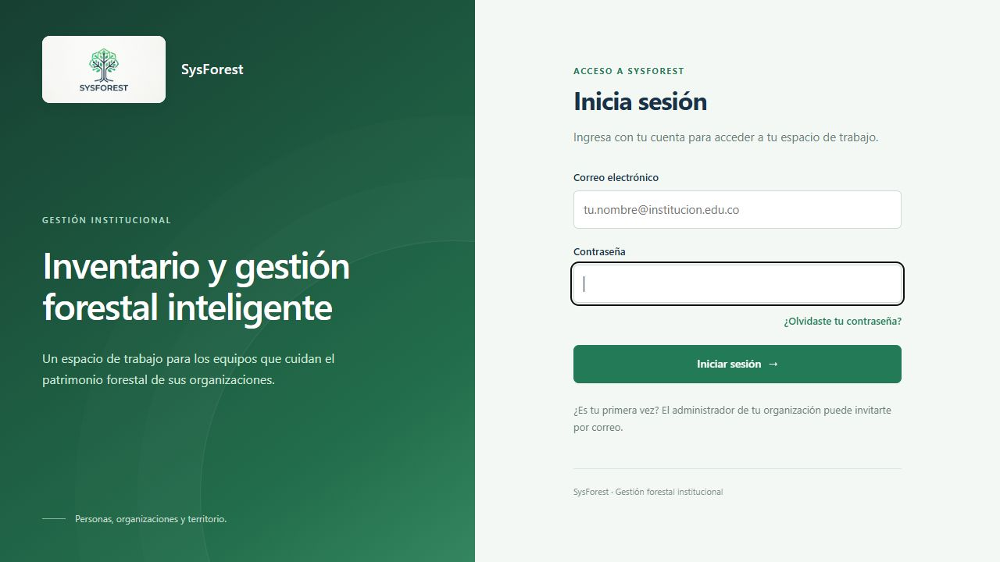

Utiliza el correo y la contraseña de tu cuenta. Si olvidaste la contraseña, el enlace de recuperación aparece antes del botón de acceso.

1. Correo electrónico: escribe la dirección de tu cuenta.
2. ¿Olvidaste tu contraseña?: solicita instrucciones de recuperación.
3. Iniciar sesión: accede al espacio autorizado.

## 3 Sesiones perfil y continuidad del trabajo

En Mi perfil puedes actualizar tu nombre, consultar membresías y asignaciones administrativas, cambiar la contraseña y cerrar sesiones propias. La cuenta es la misma en todas tus organizaciones; los permisos pueden ser distintos en cada una.

1. Abre Mi perfil y corrige Nombre completo si corresponde. Pulsa Guardar nombre.
2. Para cambiar la contraseña, escribe la actual, la nueva y su confirmación. Pulsa Cambiar contraseña.
3. Después del cambio, inicia sesión nuevamente: las sesiones existentes se cierran.
4. Revisa Tus sesiones. Identifica Esta sesión y cierra las otras que ya no utilices mediante Cerrar sesión. Cerrar esta sesión termina el acceso de la pestaña actual.

### Qué hacer cuando el acceso necesita renovarse

Si aparece Continúa tu sesión, pulsa Continuar sesión. Cuando la sesión ya terminó, utiliza Volver a iniciar sesión. Mientras completas formularios, la aplicación intenta renovar el acceso vigente y conservar lo escrito, incluidas fotografías seleccionadas. La renovación no anula una revocación administrativa ni prolonga indefinidamente la sesión.

Ante una interrupción temporal de conexión, conserva la pestaña y utiliza Comprobar sesión cuando el aviso lo ofrezca. Si se necesita autenticar de nuevo, Iniciar sesión en otra pestaña permite conservar el formulario anterior. Después comprueba cuenta e institución y abre un formulario nuevo si cambió el contexto. Una comprobación de sesión no reenvía automáticamente una escritura que ya se había enviado.

Si una operación quedó sin respuesta, consulta la ficha o el lote antes de repetirla. Cerrar el navegador o recargar puede perder datos todavía no guardados. Al terminar la jornada, utiliza Cerrar sesión, especialmente en equipos compartidos. Si se desactiva tu cuenta, membresía u organización, una pantalla abierta anteriormente no mantiene la autorización para guardar.

## 4 Roles y organización de trabajo

El acceso combina rol, ámbito autorizado y estado vigente de la cuenta. Seleccionar una institución permite trabajar en su contexto, pero no concede permisos nuevos. Un alcance nacional o departamental de consulta tampoco permite escribir en cualquier institución.

| Perfil | Responsabilidad principal | Límites relevantes |
| --- | --- | --- |
| Superadministrador | Administración nacional, catálogos y cuentas; operación forestal en una organización seleccionada. | Debe seleccionar institución para capturar, importar o publicar. Auditoría nacional. |
| Administrador departamental | Consulta de las organizaciones de sus departamentos y auditoría departamental. | No captura, modifica, importa, verifica mantenimientos ni publica por este rol. |
| Administrador de organización | Gestiona su institución, campañas, miembros, operación forestal y publicación. | No administra catálogos nacionales ni accede a la bandeja de auditoría. |
| Funcionario | Registra y corrige árboles, inspecciones, evidencias y mantenimientos; realiza importaciones autorizadas. | No administra miembros, publica, verifica mantenimientos ni accede a auditoría. |

### Cambiar de organización

1. Guarda o resuelve el trabajo pendiente en la institución actual.
2. Abre Organizaciones y localiza la tarjeta correspondiente por nombre, código y municipio.
3. Pulsa Abrir organización y confirma el nombre institucional en la pantalla siguiente.
4. Abre nuevamente la ficha o módulo donde trabajarás. No reutilices un formulario abierto en otra institución.

Resultado esperado: las bandejas operativas muestran la información del contexto elegido. En cartografía, gráficas y reportes, el selector de alcance puede ofrecer una consulta más amplia según tu asignación. Ese cambio es de lectura y no modifica la institución de las escrituras.

Si falta una opción del menú, primero comprueba tu perfil y organización. La lectura departamental permite examinar datos autorizados, pero los formularios de captura permanecen restringidos. La administración global de una cuenta es diferente de su membresía: desactivar una membresía afecta una institución; desactivar la cuenta afecta todos sus accesos.

Prioridad fitosanitaria y Carbono almacenado contienen parámetros propios de la organización. El superadministrador y el administrador de organización pueden administrar esas referencias en la entidad seleccionada; los perfiles de consulta no adquieren ese permiso por cambiar el alcance del mapa. La consulta de resultados de visitas depende del permiso de inspecciones.

### Elegir la institución correcta

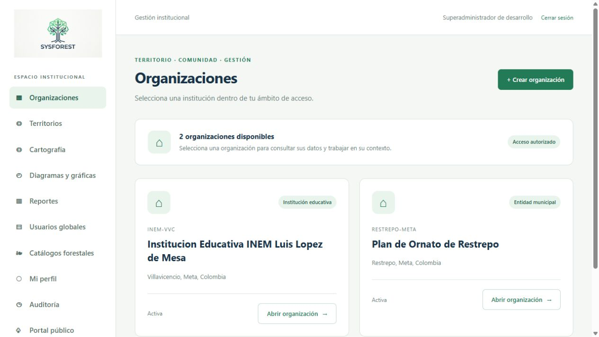

Cada tarjeta identifica una organización disponible. Comprueba nombre y municipio antes de entrar: esta selección define dónde trabajarás.

1. Nombre y municipio: identifica la institución de destino.
2. Activa: indica que la organización está disponible.
3. Abrir organización: establece el contexto de trabajo.

## 5 Crear y gestionar inventarios

Objetivo: disponer de una campaña correctamente identificada para vincular árboles nuevos o ya existentes. La creación y edición de inventarios corresponde al administrador institucional o al superadministrador con la institución seleccionada.

1. Entra en Inventarios y abre Nuevo inventario.
2. Completa Código y Nombre. El código utiliza mayúsculas, números, guiones o guiones bajos; por ejemplo, CENSO-2026. Se conserva permanentemente después de crear la campaña.
3. Añade descripción y fechas de inicio y finalización cuando se conozcan.
4. Selecciona Estado de la campaña. Para capturar o vincular árboles debe estar Activo y marcada como Inventario disponible.
5. Pulsa Crear inventario y revisa la ficha. Para una modificación posterior, utiliza su edición y Guarda los cambios.

Resultado esperado: la campaña aparece en los selectores de captura cuando cumple las condiciones de disponibilidad. Los estados de campaña son Borrador, Activo, Cerrado y Archivado. Aquí Activo describe la disponibilidad de la campaña y conserva ese nombre; Sano se utiliza únicamente para el estado del árbol.

### Reutilizar individuos entre campañas

Si un árbol ya existe y será evaluado en una nueva campaña, abre su ficha y utiliza Agregar a campañas activas y Vincular inventarios. También puedes agregar campañas desde Editar ficha. Estas acciones conservan los vínculos anteriores. No registres otro árbol solo porque cambió el año, el equipo o la campaña: las nuevas visitas se agregan como inspecciones del individuo existente.

Si no aparecen campañas al capturar, revisa que estés en la organización correcta y que haya al menos una campaña Activa y disponible. El funcionario debe solicitar al administrador su creación o habilitación. Cerrar una campaña no borra los árboles ni sus inspecciones históricas; sí puede limitar operaciones que requieren una campaña vigente.

### Encontrar o crear una campaña

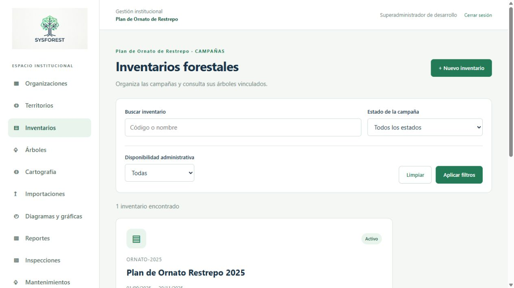

La bandeja permite buscar campañas por código o nombre y comprobar su estado. La creación de inventarios depende del permiso de tu perfil.

1. Nuevo inventario: inicia una campaña si tienes permiso.
2. Estado de la campaña: filtra Borrador, Activo, Cerrado o Archivado.
3. Disponibilidad administrativa y Aplicar filtros: acotan la bandeja.

## 6 Registrar un árbol y su identidad botánica

Antes de crear un individuo, búscalo por código, número anterior, ubicación y especie. El número legado ayuda a reconocerlo, pero no garantiza por sí mismo que no exista otro registro. La ficha de árbol reúne su identidad permanente; las medidas de una visita se registran después en una inspección.

1. En Árboles, abre Registrar árbol y confirma la organización.
2. Selecciona uno o varios Inventarios activos. El Código SYSFOREST se asignará al guardar.
3. Completa Número anterior o externo solo si existe un identificador previo. Puedes escribir 1 cuando ese sea el número real del levantamiento original; no lo uses como valor de relleno.
4. En Especie · nombre común y científico, busca y selecciona la identificación del catálogo. Familia y Nombres comunes registrados se muestran a partir de esa especie.
5. Selecciona emplazamiento, hábito de crecimiento y orígenes conocidos. Deja No informado o Sin identificar cuando falte información comprobada.
6. Registra ubicación y captura GPS según el capítulo siguiente. Selecciona el estado inicial y, si corresponde, marca Árbol protegido o Árbol patrimonial.
7. Pulsa Registrar árbol y revisa la ficha, su código, campañas e identidad botánica.

### Familia, especie y varios nombres comunes

La identificación botánica es opcional en la captura del árbol cuando todavía no se conoce. No debes inventar una especie ni completar la familia por aproximación. Una vez seleccionada la especie, su familia se deriva del catálogo; no se escribe por separado en la ficha. La familia sí es necesaria cuando un administrador nacional crea una nueva especie en el catálogo taxonómico.

Una especie puede tener varios nombres comunes y, como máximo, uno principal. Los nombres se administran en la especie y se reflejan en todos sus árboles. Por eso no se crea un árbol por cada nombre ni se escribe una lista manual de alias en el registro. Si falta un nombre local, solicita al administrador nacional su revisión. Cuando un nombre común se repite entre especies distintas, comprueba también el nombre científico antes de seleccionar.

Protegido y Patrimonial son clasificaciones independientes del estado actual. El origen de establecimiento describe cómo se estableció el individuo; el origen biogeográfico corresponde a su procedencia. Completar uno no permite deducir automáticamente el otro.

### Seleccionar la identidad botánica

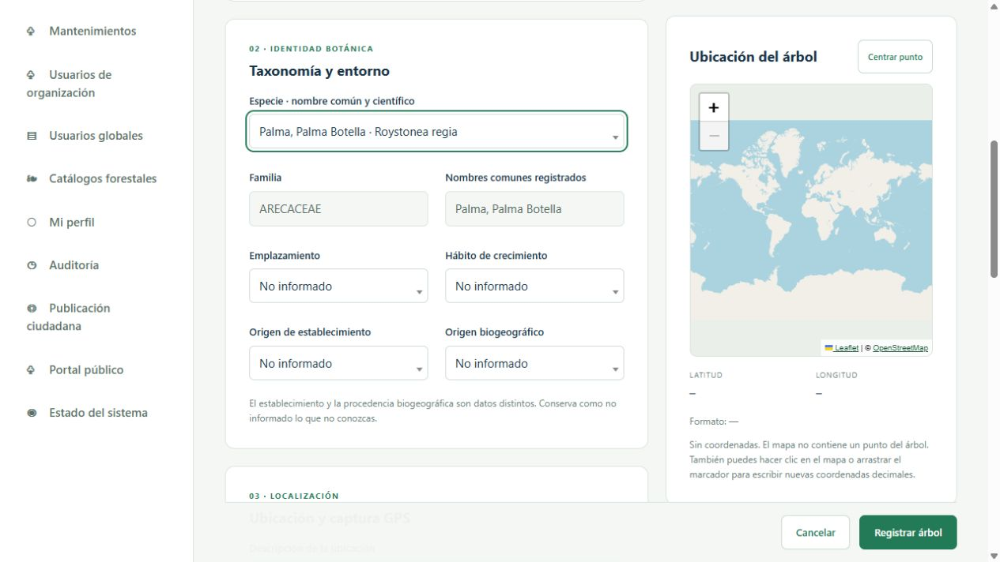

El selector reúne nombres comunes y científicos. Al elegir una especie, la familia y sus nombres registrados se muestran automáticamente.

1. Especie: busca una identificación existente del catálogo.
2. Familia: se obtiene de la especie seleccionada.
3. Nombres comunes registrados: muestra sus nombres alternativos.

## 7 Ubicación edición y estado del árbol

### Capturar una ubicación verificable

En Coordenadas originales pega la lectura del GPS en orden latitud, longitud, por ejemplo 4.609710, -74.081750. Se admiten grados decimales y grados, minutos y segundos. Comprueba el punto en la previsualización del mapa antes de guardar. Registra datum WGS84, precisión, marca y modelo solamente cuando se conozcan; la marca del dispositivo no demuestra el datum.

Fecha y hora de captura de la ubicación utiliza hora de Colombia, America/Bogota. Déjala vacía si se desconoce. Este calendario no tiene el mismo criterio que las fotografías y la auditoría, cuyos controles señalan UTC. No cambies una fecha histórica para que coincida con el día en que transcribes el dato.

1. Para corregir identificación, referencias o descripción, abre la ficha y pulsa Editar ficha. Revisa los campos y pulsa Guardar cambios.
2. Para modificar coordenadas, abre Cambiar ubicación o datos de captura desde la ficha. Introduce la lectura, selecciona Corrección, Reubicación o Trasplante y explica el motivo obligatorio.
3. Comprueba el marcador y pulsa Guardar ubicación. El historial conserva los valores anteriores.
4. Para actualizar el estado general, abre Cambiar estado del árbol, selecciona el nuevo estado, explica la observación o fuente en Motivo del cambio y pulsa Guardar estado.

### Interpretar el estado

Las opciones son Sano, En observación, Muerto, Talado, Trasplantado, Retirado y Reemplazado. Sano es la etiqueta visible que sustituyó Activo para árboles; no elimina sus inspecciones ni asegura que todas las condiciones estén evaluadas. En observación requiere seguimiento. Muerto se refiere al individuo completo: una rama muerta aislada no equivale automáticamente a la muerte del árbol.

Registrar una inspección o ejecutar un mantenimiento no cambia por sí solo el estado o la ubicación del árbol. Son acciones separadas con historial propio. Anular registro se reserva para errores de registro y requiere permiso administrativo; un individuo muerto o talado conserva su ficha con el estado correspondiente. Restaurar registro recupera la misma identidad y no restaura automáticamente fotografías anuladas por separado.

### Reconocer la ficha del individuo

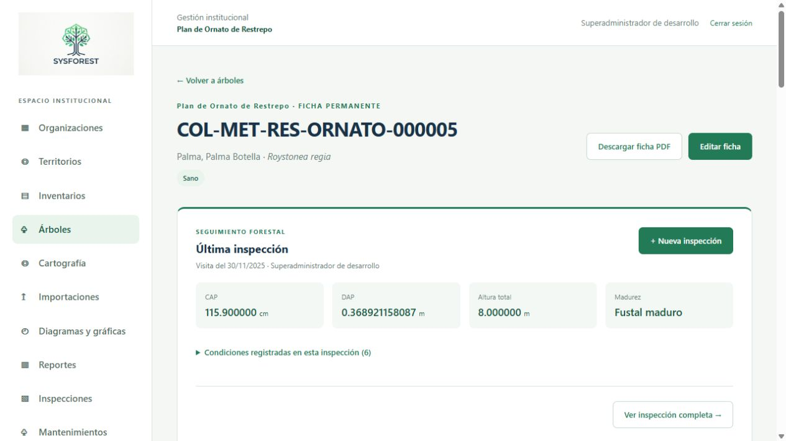

Antes de editar o registrar una nueva visita, confirma el código, los nombres y el estado del árbol. El resumen inferior corresponde a la última inspección registrada.

1. Código, nombres y estado: confirma que sea el individuo correcto.
2. Editar ficha: abre los datos permanentes del árbol.
3. Nueva inspección: agrega una visita sin crear otro árbol.

## 8 Registrar y corregir inspecciones

Objetivo: conservar lo observado en una fecha sin sobrescribir visitas anteriores. Desde la ficha del árbol, abre Nueva inspección. Usa Corregir inspección cuando se trata de un error de transcripción de una visita existente; para una nueva visita, crea una inspección nueva.

1. Revisa el código y la especie del árbol. Completa Fecha de inspección, que es obligatoria.
2. Selecciona Inventario o campaña cuando la visita corresponda a una campaña vinculada. La opción Sin campaña formal permite una visita sin ese contexto.
3. En Dasonomía registra CAP en centímetros; alturas total y comercial y ejes de copa X e Y en metros. Añade número de fustes y factor de forma cuando se conozcan.
4. Revisa los valores calculados que devuelve SysForest. No reemplaces datos desconocidos por cero ni escribas derivados para forzar resultados.
5. Marca las condiciones físicas y fitosanitarias observadas en cada órgano. Añade fenología, fauna y observaciones conocidas.
6. Confirma la prioridad según el apartado siguiente y guarda. Revisa la ficha y adjunta fotografías.

El factor de forma admitido está entre 0,45 y 0,7. El número de fustes es un conteo observado: no multiplica automáticamente los volúmenes. DAP, áreas, volúmenes, clases y otros resultados se calculan en el servidor según los datos y reglas disponibles; si faltan entradas necesarias, un resultado puede permanecer vacío.

### Condiciones, fenología y fauna

Las condiciones pueden ser múltiples. Una casilla sin marcar no acredita ausencia evaluada; registra solo lo observado y evita inferir diagnósticos. Las condiciones se conservan por órgano y por visita. En floración y fructificación puedes registrar fecha y descripción del desarrollo independientemente, sin escalas inventadas. Fauna admite varias categorías y una descripción general; una categoría no identifica por sí sola una especie animal.

Resultado esperado: la visita queda en la línea de tiempo con fecha, autor, medidas y observaciones. Para corregirla, abre su ficha, utiliza Corregir inspección y pulsa Guardar corrección. Se conserva el historial. Corregir una visita antigua no la convierte en la última: la consulta actual toma primero la fecha de inspección y aplica un orden estable cuando hay empates. El estado general del árbol requiere su cambio explícito desde la ficha.

### Confirmar la prioridad de gestión fitosanitaria

Esta prioridad ayuda a organizar la revisión del árbol a partir de las condiciones registradas. Los niveles son Bajo, Moderado, Alto y Crítico. No es una probabilidad de caída ni un diagnóstico de daño a personas. Tampoco sustituye el estado Sano, En observación o Muerto, ni crea una orden de mantenimiento.

1. Registra las condiciones físicas y fitosanitarias observadas, junto con las mediciones y observaciones de la visita.
2. En Prioridad de Gestión Fitosanitaria pulsa Actualizar sugerencia. Lee la explicación y revisa los avisos antes de decidir.
3. Selecciona la Prioridad profesional. Si difiere de la sugerencia, explica la razón en Observaciones generales.
4. Marca Confirmo la prioridad profesional y guarda. En una corrección vuelve a revisar y confirmar la decisión de esa versión.

Las condiciones contradictorias deben corregirse antes de guardar. Revisa los avisos de captura incompleta: la cobertura indica cuáles de las condiciones registradas participan en la metodología, no certifica que se hayan evaluado todos los órganos. Sin condiciones evaluables no aparece una sugerencia; para confirmar una prioridad profesional debes justificarla en Observaciones generales. Si cambió la metodología mientras tenías abierto el formulario, vuelve a consultar la sugerencia vigente.

| Resultado visible | Cómo interpretarlo |
| --- | --- |
| Bajo Moderado Alto Crítico | Existe una prioridad confirmada por una persona autorizada para esa versión de la visita. |
| Pendiente de confirmación | Hay evaluación automática, pero falta la decisión profesional. No leerla como prioridad baja. |
| Inconsistente | La información histórica contiene combinaciones que requieren revisión. |
| Sin evaluar | No existe una evaluación aplicable a la versión consultada. |

Las importaciones y capturas móviles no inventan confirmaciones profesionales. Su información puede quedar pendiente para revisión web. La ficha conserva la sugerencia, la decisión y la metodología utilizada. Cambiar parámetros de la organización no sustituye silenciosamente decisiones históricas.

### Leer el carbono aéreo almacenado de la visita

El resultado expresa biomasa aérea seca estimada, carbono almacenado en esa biomasa y la masa de CO₂ correspondiente. Son existencias estimadas para las medidas de la visita. No equivalen a huella de emisiones, captura anual, raíces, suelo ni compensaciones.

El cálculo requiere especie identificada, hábito Árbol, un solo fuste, CAP y altura total válidos, y una referencia aplicable de densidad con sus límites. Registra únicamente lo observado. No completes medidas, fustes o especie para conseguir un resultado numérico.

Si aparece pendiente, consulta el motivo: puede faltar una medición, identificación o referencia, o el individuo puede requerir otro método. Un resultado ausente significa Sin estimación, nunca cero. La etiqueta de referencia bibliográfica provisional permite distinguir una precarga documental de una revisión profesional local.

Corregir medidas, especie o hábito puede generar una nueva estimación y conservar la anterior en la historia. Los totales de stock vivo solo incluyen la última visita compatible de árboles actualmente Sanos, En observación o Trasplantados. Una visita de un árbol muerto puede conservar su estimación histórica y quedar excluida del total vivo.

### Registrar las medidas observadas

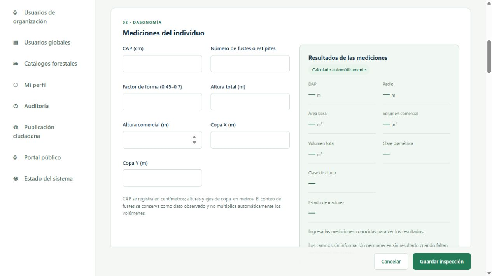

Completa solo las mediciones conocidas y respeta las unidades. Los resultados derivados aparecen en el panel de cálculos; un dato desconocido permanece vacío.

1. CAP: se registra en centímetros.
2. Alturas y Copa X/Y: se registran en metros.
3. Resultados: SysForest calcula los valores derivados.

## 9 Adjuntar y administrar fotografías

Cada fotografía pertenece a un árbol, una inspección o un mantenimiento. Elige el propietario según lo que documenta: una foto de perfil permanente puede pertenecer al árbol; una condición o fauna observada durante una visita debe quedar con esa inspección; el antes y después de una intervención corresponde a la orden. La aplicación no copia automáticamente la misma imagen entre propietarios.

1. Abre la ficha del registro y accede a la carga desde su sección de evidencias.
2. Pulsa Seleccionar imágenes o Tomar fotografía si el navegador y el dispositivo ofrecen cámara.
3. Revisa la previsualización de cada archivo y selecciona su Tipo de evidencia obligatorio. Cada fotografía tiene exactamente un tipo.
4. Añade descripción y, en Detalles opcionales, fecha de captura y notas. El calendario de fotografías indica UTC: convierte la hora conocida cuando corresponda o déjalo vacío si se desconoce.
5. Retira archivos equivocados con Quitar y pulsa Subir fotografías.
6. Comprueba que las imágenes aparezcan en la galería del registro correcto. Ante una respuesta incierta, revisa la galería antes de repetir la carga.

Con la configuración predeterminada se admiten JPEG, PNG y WEBP, hasta cinco archivos por carga y 10 MB por imagen. También se limita la resolución a 20 millones de píxeles. La pantalla muestra los límites efectivos. Sin JavaScript, el formulario permite una imagen por envío. HEIC, archivos corruptos o imágenes fuera de los límites requieren conversión o reducción antes de cargarse.

### Corregir una evidencia

Abre la fotografía y utiliza Editar datos de la evidencia para corregir tipo, descripción, fecha o notas; pulsa Guardar datos. Esta edición no reemplaza el archivo ni cambia su propietario. Si seleccionaste una fotografía equivocada, utiliza Anular evidencia y carga la correcta. La anulación conserva trazabilidad; Restaurar evidencia requiere un perfil autorizado y que el archivo continúe disponible.

Abrir imagen y Descargar original requieren acceso privado vigente. Las fotos nacen privadas y su publicación se administra por separado. Al anular el árbol raíz se bloquean nuevas cargas y correcciones relacionadas; restaurarlo no recupera automáticamente evidencias anuladas de forma independiente.

### Preparar la carga de fotografías

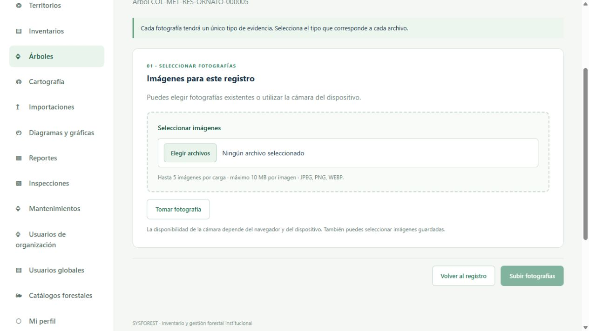

Abre esta pantalla desde el árbol, inspección o mantenimiento que debe conservar la imagen. Revisa los formatos y límites antes de seleccionar archivos.

1. Seleccionar imágenes: elige los archivos que vas a adjuntar.
2. Límites de carga: comprueba cantidad, tamaño y formatos.
3. Subir fotografías: confirma el envío después de clasificar los archivos.

## 10 Programar ejecutar y cerrar mantenimientos

Una orden documenta una intervención sobre un árbol. Se crea manualmente; una condición de inspección no genera por sí sola una orden. Desde la ficha del árbol abre el registro de mantenimiento y completa el tipo, prioridad, fecha programada, responsable conocido y notas. La nueva orden comienza Pendiente, incluso cuando ya se escribió un responsable.

### Flujo de seguimiento y cierre

1. Abre la orden desde Mantenimientos o la ficha del árbol. Revisa Seguimiento y cierre.
2. Si se requiere, programa la fecha. En Asignar responsable selecciona una persona elegible de la institución y confirma la asignación. Escribir el nombre al crear la orden no sustituye esta transición.
3. Al comenzar la actividad, utiliza Iniciar ejecución. El sistema vuelve a comprobar que el responsable sea vigente.
4. Al terminar, utiliza Registrar ejecución, selecciona la fecha real no futura y escribe el resultado. Adjunta evidencias antes/después cuando existan.
5. El administrador institucional o superadministrador revisa el trabajo y pulsa Verificar y cerrar mantenimiento. La ficha muestra Mantenimiento cerrado y verificado.

Resultado esperado: quedan registradas las transiciones, fechas, responsables y resultado. El funcionario puede ejecutar, pero no verificar el cierre; después ve Pendiente de verificación administrativa. Los estados son Pendiente, Programado, Asignado, En ejecución, Ejecutado, Verificado y Cancelado. Reprogramar desde Asignado retira la asignación y obliga a revisarla.

Baja, Normal, Alta y Urgente son prioridades de organización del trabajo. No representan por sí mismas un cálculo de riesgo ni generan alarmas o plazos automáticos. El responsable debe tener cuenta y membresía vigentes y un rol operativo adecuado en la institución. Las órdenes terminadas conservan sus datos y no tienen una reapertura silenciosa.

### Cancelar o anular

Cancelar trabajo indica que la intervención no se realizará y requiere explicar el motivo. Anular registro por error corrige una orden creada equivocadamente y exige permiso administrativo; no certifica ejecución. Una tala o un trasplante registrados como mantenimiento no modifican automáticamente el estado o las coordenadas: revisa y actualiza por separado la ficha del árbol. No hay planificación recurrente ni avisos de mantenimiento por correo implementados en este flujo.

### Preparar una orden de mantenimiento

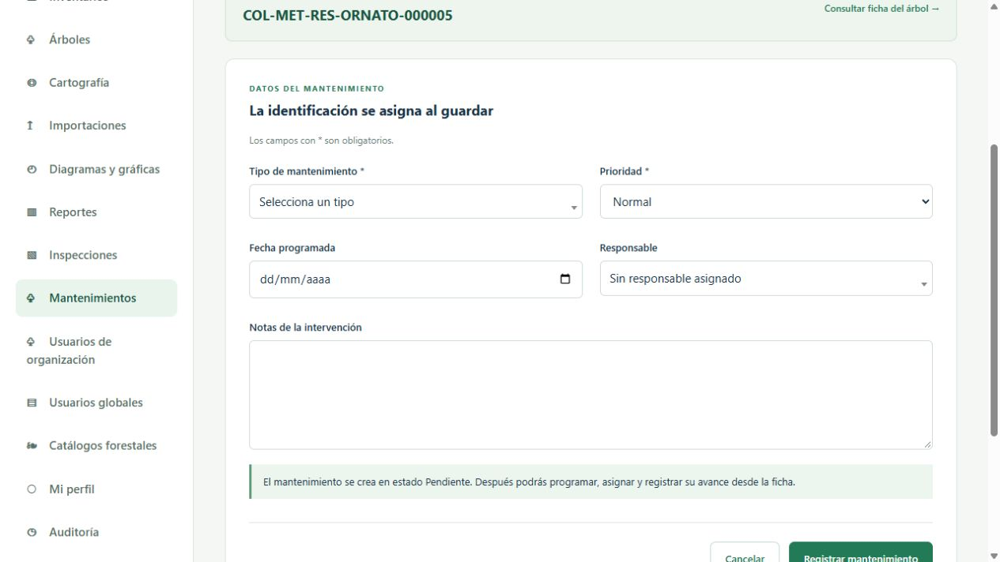

La nueva orden identifica la intervención y su programación. Después de guardarla comienza en Pendiente; la asignación y el avance se confirman desde su ficha.

1. Tipo de mantenimiento y Prioridad: describen la intervención.
2. Fecha programada: indica cuándo se prevé realizar el trabajo.
3. Responsable y Notas: aportan el contexto operativo inicial.

## 11 Preparar la plantilla oficial de Excel

La importación registra árboles nuevos con su inspección inicial. Utiliza siempre Descargar plantilla oficial desde Importaciones. La versión vigente está en español e incluye Datos, Guía de campos, Instrucciones y ocho hojas de catálogos. Los libros V1 anteriores siguen siendo compatibles, pero conviene comenzar una carga nueva con la plantilla actual.

1. Descarga un libro nuevo y lee Instrucciones y Guía de campos antes de completar los datos.
2. Trabaja únicamente en Datos, desde la fila 2. Conserva encabezados, orden de columnas y estructura del libro.
3. Usa los desplegables de estados y catálogos. Las referencias muestran Nombre [código]; también puedes escribir el código exacto del catálogo.
4. En condiciones, Protegido y Patrimonial utiliza los valores permitidos 0 o 1. No confundas un dato desconocido con una condición evaluada: consulta la guía de esa columna antes de completarla.
5. En Fauna, el desplegable selecciona una categoría. Si necesitas varias, escribe sus códigos separados por |, sin repetir categorías.
6. Usa fechas de calendario como texto AAAA-MM-DD, decimales con punto y el formato indicado en la guía para cada fecha y hora. Deja vacíos los campos calculados y los reservados para fotografías.
7. Guarda como .xlsx, sin macros, fórmulas, imágenes ni objetos agregados. No conviertas un reporte exportado en plantilla de importación.

### Identificación y campos desconocidos

En Código de especie selecciona la referencia del catálogo. Deja vacías las columnas Nombre común, Nombre científico y Familia: SysForest las obtiene de esa selección y no importa nombres libres. La especie es opcional si aún no se identificó; no inventes equivalencias para completarla. N. ÁRBOL / número legado guarda el identificador previo: 1 es correcto solo si corresponde al árbol número 1 de la fuente. No es el código permanente generado por SysForest y no sirve como garantía automática contra duplicados.

Las listas facilitan la captura, pero el servidor vuelve a comprobar códigos, nombres, relaciones y actividad de las referencias. Una opción que era válida al descargar el libro puede cambiar antes de cargarlo. Con la configuración predeterminada, cada archivo admite hasta 100 filas y 5 MB. Si tu levantamiento supera el límite, organiza lotes controlados sin repetir individuos.

### Comenzar con la plantilla oficial

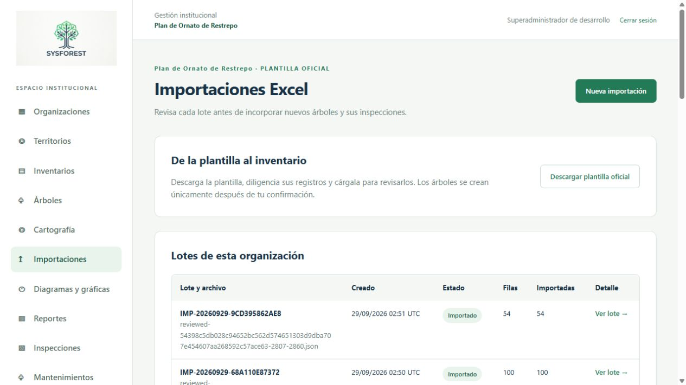

Descarga la plantilla desde Importaciones y conserva su estructura. La carga masiva incorpora árboles nuevos y requiere revisar el archivo antes de confirmarlo.

1. Importaciones Excel: reúne las cargas de la organización.
2. Descargar plantilla oficial: obtiene el libro vigente en español.
3. Nueva importación: inicia la carga de un archivo diligenciado.

## 12 Revisar confirmar y evitar importaciones duplicadas

Objetivo: revisar todas las filas antes de incorporar información. La carga del archivo solo prepara una vista previa; no crea árboles. Verifica el destino en cada lote, especialmente cuando gestionas más de una institución o campaña.

1. En Importaciones abre Nueva importación Excel.
2. Selecciona Inventario de destino y la plantilla diligenciada. Pulsa Cargar y revisar archivo.
3. Comprueba nombre del archivo, institución, campaña y totales de filas revisadas, válidas y con errores.
4. En Revisión por fila despliega los valores y cálculos. El número señalado corresponde a la fila de la hoja Datos.
5. Si hay errores, corrige el archivo en Excel y utiliza Cargar archivo corregido para crear una revisión nueva. El lote inválido no se confirma parcialmente.
6. Si todo es correcto, marca que revisaste las filas y el destino y pulsa Confirmar importación.
7. Comprueba el total Árboles importados y consulta las fichas creadas. Adjunta las fotografías después, desde Evidencias.

Si durante la confirmación cambió una referencia o un cálculo, la aplicación exige revisar la vista previa actualizada. La revisión vence a las 24 horas por defecto. Una revisión caducada requiere una carga nueva para validar información vigente. Cancelar este lote detiene un lote pendiente y conserva el registro de revisión.

### Qué evita el sistema y qué debes controlar

Volver a confirmar un lote ya completado devuelve su resultado sin duplicarlo. La huella del archivo impide repetir el mismo archivo binario confirmado. Un código de árbol existente, incluso anulado, bloquea una nueva incorporación con ese código. Estas protecciones no reconocen necesariamente un archivo regrabado con códigos nuevos como los mismos individuos físicos.

Por eso conserva una relación de lotes confirmados y sus individuos, y consulta el estado antes de repetir una carga que perdió conexión. No cambies el nombre, contenido o códigos solo para superar un aviso de duplicidad. Una importación no actualiza árboles existentes: utiliza Editar ficha y Corregir inspección, o crea una nueva visita. Para incluir un árbol existente en otra campaña, vincúlalo a esa campaña. La sincronización móvil tiene su propio contrato de reintentos y no utiliza la misma lógica del libro Excel.

Las filas importadas no llevan una decisión profesional de prioridad ni factores de carbono añadidos a la plantilla. El servidor calcula los resultados aplicables y deja pendientes explícitos. Las contradicciones de condiciones deben corregirse; la recuperación histórica excepcional no habilita el mismo trato para nuevas cargas.

### Cargar el archivo para revisión

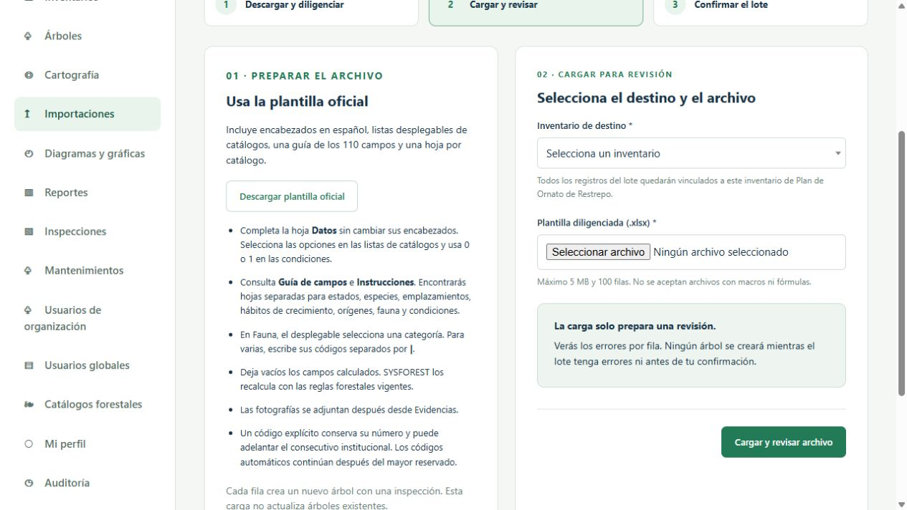

Selecciona el inventario y el XLSX. Esta acción prepara una revisión: todavía no crea árboles ni reemplaza la confirmación posterior del lote.

1. Inventario de destino: verifica dónde quedarán vinculadas las filas.
2. Plantilla diligenciada: selecciona el archivo .xlsx preparado.
3. Cargar y revisar archivo: obtiene la vista previa y sus errores.

## 13 Buscar y combinar filtros correctamente

Los filtros de Nombre común y Nombre científico son selectores con búsqueda en las bandejas correspondientes, cartografía, gráficas, reportes y consulta pública. Escribe parte del nombre y elige la opción del catálogo. Los campos de código, búsqueda general, fechas y rangos numéricos conservan entradas apropiadas para esos datos.

1. Selecciona el alcance e institución cuando el módulo lo permita. Añade inventario o territorio si necesitas acotar la consulta.
2. En Nombre científico elige la especie, o en Nombre común elige cualquiera de sus nombres registrados.
3. Comprueba el nombre científico que acompaña a cada nombre común; permite distinguir nombres iguales de especies diferentes.
4. Añade estado, emplazamiento u otras referencias y los límites de fecha o medidas que correspondan.
5. Aplica los filtros y revisa las etiquetas de criterios activos. Si el resultado es vacío, limpia criterios por etapas antes de concluir que faltan datos.

Cualquiera de los nombres comunes de una misma especie encuentra los mismos árboles sin multiplicarlos. Si seleccionas nombre común, nombre científico y familia a la vez, todos deben coincidir: los criterios se combinan. Al cambiar una referencia superior pueden limpiarse las selecciones dependientes; revisa el formulario antes de aplicar. Los filtros permiten consultar referencias históricas inactivas, aunque ya no puedan elegirse para capturas nuevas.

### Última inspección y condiciones

En los filtros actuales de árboles, mapas y análisis, las condiciones y medidas corresponden a la última inspección pertinente del individuo. No se busca una visita antigua solo porque coincida. Cualquiera de las condiciones permite que coincida al menos una; Todas exige que estén en la misma inspección. No combina una condición de un año con otra de una visita diferente.

La bandeja histórica de Inspecciones permite consultar visitas y sus propias fechas y campañas. En cambio, filtrar un inventario en la consulta de árboles selecciona individuos vinculados a la campaña; no reemplaza automáticamente la última visita global por la última de esa campaña. Los enlaces antiguos que contienen búsquedas textuales siguen funcionando y muestran un aviso: revisa ese criterio adicional o límpialo para iniciar una consulta nueva.

El filtro Prioridad fitosanitaria consulta la última inspección pertinente y permite distinguir niveles confirmados, pendientes, inconsistentes y sin evaluar. Si el árbol tiene visitas anteriores con otra prioridad, esas visitas no convierten la prioridad actual en varias categorías.

### Buscar por especie o nombre común

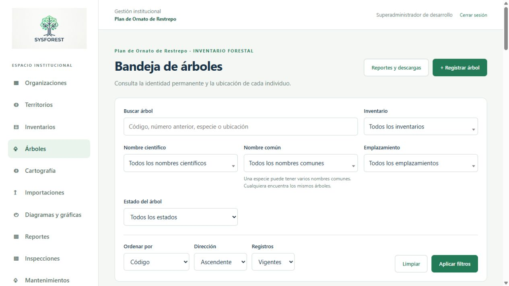

Los nombres se seleccionan desde el catálogo. Cualquiera de los nombres comunes de una misma especie encuentra sus árboles sin duplicarlos.

1. Buscar árbol: consulta código, número anterior, especie o ubicación.
2. Nombre científico: selecciona la especie que buscas.
3. Nombre común: elige un nombre registrado de esa especie.

## 14 Utilizar la cartografía operativa y territorial

En Cartografía, Mapa operativo ayuda a localizar individuos y abrir sus fichas. Análisis territorial muestra su distribución y densidad. Ambos conservan los filtros del mismo conjunto autorizado; cambiar de modo no crea otro inventario.

1. Selecciona el alcance disponible y aplica los filtros. Revisa Total filtrado, En este encuadre y Sin ubicación.
2. Elige Puntos, Agrupaciones o Densidad. Acerca el mapa o activa una agrupación para explorar individuos.
3. Usa Localizar un árbol para buscar por código o nombre dentro de los filtros aplicados. Abre un punto y su ficha cuando corresponda.
4. Pulsa Ver extensión de los resultados para encuadrar el conjunto. Puedes activar límites territoriales y cambiar el mapa base mediante el selector de capas.
5. Utiliza Compartir filtros para copiar la dirección. Quien reciba el enlace necesita sus propios permisos; el enlace no concede acceso.

Total filtrado incluye árboles sin coordenadas; por eso puede superar los marcadores. El dibujo de puntos tiene un límite de respuesta, mientras los conteos y exportaciones conservan su universo. Densidad representa concentración de registros, no riesgo, enfermedad ni cobertura de copa. La intensidad es relativa al encuadre: un mismo color en dos vistas no demuestra la misma cantidad absoluta.

### Mapas base y herramientas

OpenStreetMap ofrece contexto de calles; Relieve · OpenTopoMap aporta referencia topográfica; Satélite NASA · referencia 2004 es un mosaico histórico regional de agosto de 2004. Este último no permite identificar árboles individuales ni cambios recientes. Ampliar por encima de su resolución disponible no añade detalle. Mantén visibles las atribuciones de los proveedores.

Ubicarme solicita permiso del navegador y marca una posición temporal. Ver mi ubicación centra el mapa. Medir distancia y Medir área permiten añadir vértices, Deshacer punto y Finalizar; también puedes mover el mapa con teclado y usar Añadir centro. Borrar medición retira el trazado. Son aproximaciones que no sustituyen un levantamiento ni actualizan coordenadas del inventario.

En Tus capas locales, + Añadir GeoJSON superpone archivos WGS84 con coordenadas longitud, latitud. Se admiten hasta tres capas de 2 MiB, 3.000 elementos y 30.000 posiciones cada una. El archivo se lee solo en el navegador, no filtra datos ni se sube al servidor. Capas, ubicación y mediciones se pierden al recargar y no se incluyen al compartir filtros. Si falla el fondo cartográfico, los datos del arbolado pueden seguir disponibles.

En los mapas privados, el marcador puede mostrar un contorno de prioridad fitosanitaria además del estado del árbol. Abre el punto para leer ambas etiquetas: no confundas el contorno de prioridad con el color del estado. El popup presenta carbono cuando tu acceso permite consultar inspecciones; una estimación excluida del stock vivo se identifica como tal.

### Explorar el arbolado en el mapa

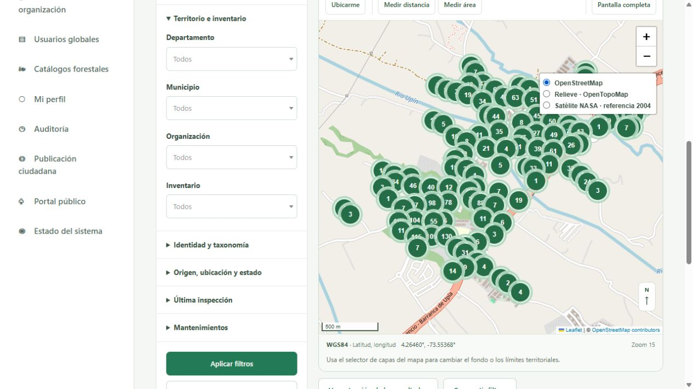

Las agrupaciones reúnen los árboles con ubicación dentro del encuadre. Activa una agrupación o acerca el mapa para explorar sus individuos.

1. Números de las agrupaciones: indican cuántos árboles reúnen.
2. Selector de mapas base: cambia entre calles, relieve y referencia NASA de 2004.
3. Controles + y −: ajustan el acercamiento del mapa.

## 15 Interpretar diagramas y gráficas

Diagramas y gráficas presenta la composición del conjunto seleccionado, su condición y gestión, comparaciones de inventarios y registros en el tiempo. Aplica los filtros antes de interpretar los indicadores. Mover el mapa o agregar una capa local no limita este tablero; un filtro de radio explícito sí modifica la selección.

1. Abre Diagramas y gráficas y revisa el alcance indicado en el encabezado.
2. Aplica los filtros de territorio, inventario, nombres, estado o condiciones necesarios.
3. Lee Árboles seleccionados, Con ubicación, Especies identificadas y Sin ubicación.
4. Recorre Composición, Condición y gestión, Comparar inventarios, En el tiempo o Todo.
5. Abre Cómo interpretar este análisis y las advertencias de cada gráfica. Usa Ver tabla de datos para comprobar los valores completos.
6. Cuando tu perfil permita descargar, elige Imagen PNG, Datos CSV o Excel si está disponible en esa gráfica.

En Del registro al territorio, ubicación e inspección son ramas independientes. Un mismo árbol puede estar en ambas y sus cantidades no deben sumarse como etapas. Del mismo modo, condiciones y campañas pueden superponerse: un individuo con dos condiciones cuenta en ambos grupos sin representar dos árboles. Mantenimientos cuenta órdenes; consulta también el dato de individuos distintos.

Las gráficas de especies y familias muestran los grupos principales y reúnen otros en Otros grupos. Las tablas conservan el detalle completo y permiten páginas de 100 filas cuando JavaScript está activo. Una gráfica sin registros no completa categorías con valores supuestos.

### Fechas y descargas

La serie histórica dibuja hasta los últimos 36 meses con registros; no completa meses ausentes con cero ni mide crecimiento biológico. Una fecha importada puede ser de referencia: en el conjunto histórico de Restrepo, 30/11/2025 corresponde a la entrega autorizada, no a un día conocido de visita. Considera esta advertencia al comparar periodos.

PNG guarda la gráfica representada; CSV incluye todos los grupos autorizados de la consulta. Las descargas incluyen contexto de filtros y avisos. Excel se ofrece en las gráficas respaldadas por reportes; comparación de inventarios y serie mensual ofrecen CSV y PNG. No todas las gráficas tienen todos los formatos, y la ausencia de un botón puede depender del permiso de exportación.

### Analizar prioridad y carbono

En Condición y gestión consulta Prioridad fitosanitaria, Carbono aéreo almacenado por especie y Cobertura de estimación. La prioridad agrupa decisiones profesionales y separa registros pendientes; cada institución puede aplicar una metodología propia. Para comparar instituciones, revisa también sus metodologías y fechas.

El gráfico de carbono suma la última visita compatible de los árboles incluidos en stock vivo. Consulta la cobertura y la cantidad de referencias provisionales antes de interpretar un total. Un PNG identifica los datos sin estimación; no transformes una ausencia en un cero ni sumes visitas históricas como si fueran árboles distintos.

### Leer la gráfica y comprobar sus datos

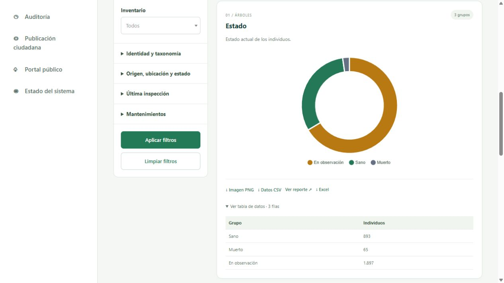

La visualización resume el conjunto filtrado. Consulta la tabla para comprobar los grupos y utiliza los controles de descarga cuando estén habilitados.

1. Estado: representa el estado actual de los árboles seleccionados.
2. Ver tabla de datos: muestra los valores que respaldan la gráfica.
3. Imagen PNG: descarga la visualización para compartirla.

## 16 Consultar reportes y descargar resultados

Reportes reúne inventario general, especies, familias, origen, hábito, estado, clases de diámetro y altura, condiciones físicas y fitosanitarias, mantenimientos, municipios, organizaciones, inspecciones, fauna y clasificaciones protegida/patrimonial. La opción Árboles por zona permanece no disponible hasta que se defina ese catálogo; no equivale automáticamente a municipio o emplazamiento.

1. Abre Reportes y comprueba el alcance autorizado.
2. En Selecciona un reporte elige el análisis y pulsa Ver reporte.
3. Aplica los filtros y revisa Filtros aplicados, avisos y los totales Árboles seleccionados, Filas del reporte, Con ubicación y Sin ubicación.
4. Examina la Vista previa para confirmar que la unidad sea la esperada: árboles, grupos o mantenimientos.
5. En Descargar resultados selecciona uno de los formatos ofrecidos. La descarga incluye todos los resultados filtrados, no solo la página visible.
6. Para el perfil individual de un árbol, abre su ficha y utiliza Descargar ficha PDF cuando esté disponible.

### Elegir un formato

- Excel: libro para revisar y compartir datos tabulares. Conserva los criterios y el contenido autorizado del reporte.
- CSV: intercambio de tablas con otras herramientas. Al importarlo en una hoja de cálculo conserva identificadores como texto y revisa separador y codificación.
- GeoJSON: consulta geográfica para herramientas de cartografía, cuando el reporte ofrece este formato. Los árboles sin geometría no generan un punto visible.
- PDF: lectura o impresión de reportes y fichas. Un PDF tabular está pensado para selecciones acotadas.

Los límites predeterminados son 50.000 filas privadas, 10.000 públicas y 200 filas para PDF tabular. Si la selección supera el límite, reduce fechas o criterios. La aplicación rechaza el excedente en lugar de entregar un archivo truncado. El límite de marcadores o la zona visible del mapa no recortan una descarga de reportes.

No interpretes todos los totales como individuos únicos: las tablas de condiciones o campañas pueden contener pertenencias múltiples y los mantenimientos representan órdenes. El resumen de inspecciones indica árboles con o sin última inspección, no la cantidad completa de visitas históricas. Los archivos de consulta no reemplazan la plantilla de importación y no deben recargarse para actualizar registros existentes.

Los reportes privados de prioridad fitosanitaria y carbono comparten el alcance y los filtros elegidos. El inventario detallado incluye prioridad, sugerencia, metodología, confirmación y referencia del cálculo. El reporte de carbono por especie separa estimados incluidos, provisionales y pendientes o excluidos; una suma vacía indica ausencia de estimaciones. Revisa estas columnas antes de distribuir un resultado agregado.

### Revisar y descargar un reporte

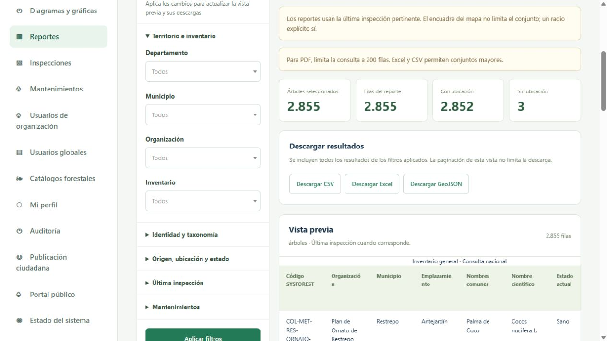

Comprueba la selección y las cantidades antes de descargar. El archivo incluye los resultados autorizados de los filtros aplicados, no solo la página de vista previa.

1. Árboles seleccionados y Filas del reporte: revisa las cantidades.
2. Con ubicación y Sin ubicación: comprueba la cobertura geográfica.
3. Descargar CSV, Excel o GeoJSON: elige el formato disponible.

## 17 Publicación ciudadana y portal público

Todo registro nace privado. Publicación ciudadana permite al administrador institucional o superadministrador autorizar la información de su institución. La visibilidad requiere una cadena completa: organización autorizada y disponible, campaña autorizada y disponible fuera de Borrador, árbol autorizado y no anulado. Inspecciones y fotografías tienen además su propia autorización.

1. Selecciona la organización correcta y entra en Publicación ciudadana.
2. En Administrar publicación revisa Antes de publicar y elige el tipo de registro correspondiente.
3. Localiza el registro. En Visibilidad autorizada selecciona Autorizar publicación y pulsa Guardar autorización.
4. Repite la revisión para la campaña y árboles pertinentes. Autoriza expresamente las inspecciones y fotografías que se deban mostrar.
5. En fotografías, revisa Descripción pública opcional: ese texto sí aparece públicamente. Excluye nombres del personal, contactos y notas operativas.
6. Abre Portal público sin sesión y comprueba la ficha, datos e imágenes visibles. Una autorización guardada no garantiza visibilidad si falta otra parte de la cadena.

Para retirar información, selecciona Mantener privado y guarda. Ocultar un propietario retira sus dependientes de la siguiente consulta sin borrar la historia ni necesariamente quitar sus autorizaciones individuales. Los cambios posteriores de datos estructurados de un registro publicado se reflejan en el portal; vuelve a revisar cuando corrijas información relevante.

### Qué recibe la ciudadanía

El portal permite consultar árboles publicados, mapa, indicadores y reportes públicos sin una cuenta institucional. Recibe una selección explícita de datos; no muestra usuarios, auditoría, notas internas ni archivos fotográficos originales con metadatos. La última inspección pública puede diferir de la última visita privada, por lo que los totales o condiciones pueden ser distintos a los de la aplicación institucional.

Los mantenimientos de árboles publicables ofrecen un resumen mínimo únicamente cuando están Ejecutados o Verificados. El resumen no incluye responsables, notas o resultados internos. Una fotografía de mantenimiento requiere autorización propia y que la orden y el árbol cumplan las condiciones de visibilidad. La verificación del mantenimiento no publica automáticamente sus imágenes.

Publicar o despublicar una visita cambia su visibilidad y conserva sus resultados de riesgo y carbono, sin representar una nueva confirmación profesional. Estas dos evaluaciones y sus parámetros siguen siendo privados: el portal ciudadano no las recibe por publicar la visita.

## 18 Auditoría consultar acciones y exportar Excel

La bandeja Auditoría está reservada exclusivamente a superadministrador y administrador departamental. El administrador institucional y el funcionario no tienen acceso a esta bandeja ni a su exportación. Los historiales propios visibles dentro de fichas autorizadas no equivalen a disponer de la bandeja global de auditoría.

El superadministrador consulta por defecto el ámbito nacional, incluidos eventos sin institución. El administrador departamental consulta las instituciones de sus departamentos autorizados, incluso el historial de instituciones inactivas o archivadas dentro de ese ámbito. Los eventos sin institución permanecen nacionales. Seleccionar una organización operativa no amplía ni sustituye automáticamente ese alcance.

1. Abre Auditoría y comprueba el alcance presentado. La consulta inicial cubre los últimos 30 días UTC.
2. Selecciona Desde y Hasta mediante sus calendarios. Ambos días se incluyen completos; Hasta no puede ser anterior a Desde.
3. Combina Módulo, Acción, Usuario e institución cuando corresponda. Las opciones están limitadas a tu actividad y territorio autorizados.
4. Aplica los filtros y revisa las entradas. Abre un detalle para examinar valores anteriores y nuevos disponibles.
5. Para descargar el conjunto filtrado, pulsa Exportar Excel. No es necesario recorrer todas las páginas antes de exportar.

### Leer fechas y cambios

Las fechas de auditoría se interpretan en UTC. Para contrastarlas con una hora de Colombia, UTC equivale a cinco horas más; un evento nocturno local puede pertenecer al día UTC siguiente. Los nombres de usuarios e instituciones se muestran según su estado actual. Un evento antiguo sin valores capturados se identifica expresamente: la aplicación no inventa el valor previo.

El Excel contiene Eventos, Cambios y Criterios. Incluye todos los resultados coincidentes, hasta 50.000 eventos por descarga de forma predeterminada. Si se supera el límite, reduce el periodo o añade filtros; no se genera un recorte silencioso. Criterios permite documentar alcance, fechas y cantidades de la consulta.

Si aparece un aviso de consulta desde la fuente transaccional, puedes seguir revisando el historial autorizado: indica que la proyección de consulta está pendiente o temporalmente indisponible. No es una instrucción para repetir operaciones forestales. La auditoría es de solo lectura y no ofrece edición ni eliminación de eventos.

### Filtrar la actividad y exportarla

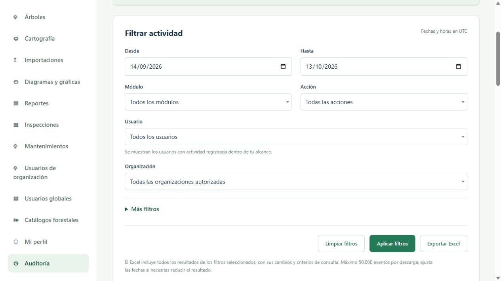

La bandeja está reservada al superadministrador y al administrador departamental. El calendario se interpreta en UTC y los filtros se conservan al exportar.

1. Desde y Hasta: incluyen ambos días completos en UTC.
2. Módulo, Acción y Usuario: combinan criterios dentro del alcance.
3. Exportar Excel: descarga todos los eventos que cumplen los filtros.

## 19 Administración de usuarios y catálogos

### Administrar el equipo institucional

1. Como administrador autorizado, selecciona la institución y abre Usuarios de organización.
2. Pulsa Invitar usuario, completa los datos solicitados y revisa el rol y correo de destino antes de enviar la invitación.
3. Consulta Invitaciones enviadas para verificar estado y vencimiento. La persona aparecerá como miembro cuando complete su incorporación.
4. En Usuarios y membresías, ajusta Estado de la membresía y Rol en la organización según tus permisos. Pulsa Guardar.
5. Revisa que la persona tenga cuenta global activa y correo verificado. Una membresía activa no habilita una cuenta global desactivada.

Una membresía solo afecta la institución seleccionada. Para la administración global, el superadministrador utiliza Usuarios globales: puede gestionar el estado de cuenta y asignaciones nacionales o departamentales. Asignar un departamento concede su alcance de consulta y auditoría correspondiente, no facultades de escritura forestal. Los roles institucionales se gestionan desde cada membresía.

### Mantener referencias forestales nacionales

Catálogos forestales reúne referencias compartidas entre instituciones, como taxonomía, emplazamientos, hábitos, orígenes, condiciones, fauna, evidencias y tipos de mantenimiento. Los perfiles autorizados pueden consultarlas; solo superadministrador crea o modifica los catálogos nacionales. Un cambio puede afectar la presentación de registros de varias organizaciones.

1. Busca primero el valor existente para evitar duplicados o variantes de escritura.
2. Para una especie, selecciona su familia y registra el nombre científico y código estable. Para un nombre común, selecciona la especie a la que pertenece.
3. Agrega cada nombre común como una referencia de esa especie. Marca como principal, a lo sumo, uno; conserva los demás como nombres alternativos.
4. Revisa descripción y procedencia, orden de presentación y estado. Pulsa Guardar valor.
5. Si una referencia deja de estar disponible para capturas nuevas, utiliza su estado Inactivo según el procedimiento administrativo, conservando las referencias históricas.

No reutilices códigos estables para representar otra especie o significado. Los filtros históricos pueden seguir mostrando valores inactivos. Esa disponibilidad de consulta no implica que puedan elegirse nuevamente al capturar. Cuando una ficha conserva una referencia histórica, no la reemplaces solo para quitar la etiqueta de inactividad: primero verifica la identificación y el motivo del cambio.

### Administrar la metodología fitosanitaria institucional

Abre Prioridad fitosanitaria en la organización correcta. Revisa los pesos de condiciones, órganos evaluados, reglas y matriz de niveles. Publicar una nueva versión exige el permiso de administración y la justificación solicitada. La matriz debe mantener la progresión permitida por la validación: una afectación mayor no debe terminar en una prioridad menor.

La versión nueva se aplica a evaluaciones nuevas o corregidas; no modifica retrospectivamente las decisiones profesionales existentes. Los catálogos nacionales describen condiciones, mientras la metodología institucional determina cómo interpretarlas. No cambies una condición nacional para ajustar únicamente el criterio de tu institución.

### Administrar referencias de carbono

1. Abre Carbono almacenado en la entidad correspondiente y busca la especie.
2. Revisa si la referencia es bibliográfica provisional, profesional, pendiente o requiere otro método.
3. Si cuentas con respaldo profesional, registra aplicabilidad, densidad básica, límites y fuente; explica la decisión y confirma la revisión para publicar una versión.
4. Para aplicar las referencias actuales a visitas existentes, solicita Actualizar estimaciones de esta entidad y consulta su progreso.

Publicar una referencia conserva los resultados anteriores. La actualización agrega instantáneas usando las referencias vigentes; repetir una ejecución sin cambios no debe duplicarlas. Una referencia no aplicable necesita también esa actualización para reflejarse en visitas existentes. No traslades factores de otra institución sin evaluación ni uses densidad de una especie parecida como sustituto.

Las referencias bibliográficas precargadas permiten cálculos preliminares y no acreditan revisión profesional local. Revisa cobertura, límites y procedencia antes de emplear los resultados para una decisión técnica. El apartado no calcula una huella institucional de emisiones.

### Seguir una actualización de estimaciones

La solicitud se ejecuta en segundo plano. El panel muestra En cola, En proceso, Completado, Cancelado o Fallido; informa visitas procesadas frente al total y estimaciones agregadas. Puedes continuar trabajando y volver a Carbono almacenado. Con JavaScript el progreso se consulta automáticamente; Consultar progreso permite recargar la página.

Mientras exista una ejecución activa en la entidad no se crea otra. Si cambian las referencias durante el proceso, la ejecución se cancela con aviso: solicita una nueva actualización para aplicar la versión vigente a todas las visitas. Si el solicitante pierde permiso, debe solicitarla otro administrador autorizado. Ante un fallo, revisa el mensaje y solicita otra ejecución cuando se resuelva la causa; los resultados ya confirmados se conservan.

Un proceso incompleto puede haber actualizado parte de las visitas. Revisa el estado de la tarea y la cobertura antes de distribuir un total. La actualización no evalúa científicamente una referencia, no confirma prioridades y no modifica los datos medidos.

### Entender el carbono almacenado

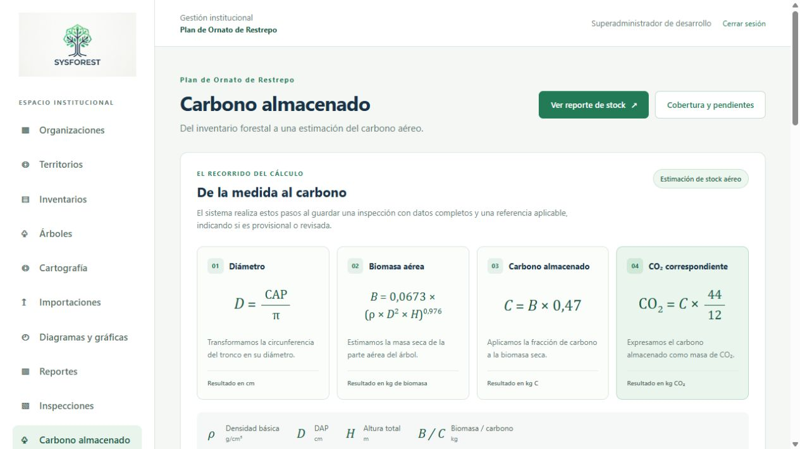

La pantalla muestra el recorrido desde las medidas del árbol hasta el carbono aéreo almacenado. Comprueba la cobertura y el estado de la referencia antes de interpretar o descargar un total.

1. De la medida al carbono: distingue diámetro, biomasa, carbono y CO₂ correspondiente.
2. Ver reporte de stock: consulta las estimaciones y su cobertura.
3. Cobertura y pendientes: revisa los registros que aún no tienen una estimación.

### Revisar la metodología institucional

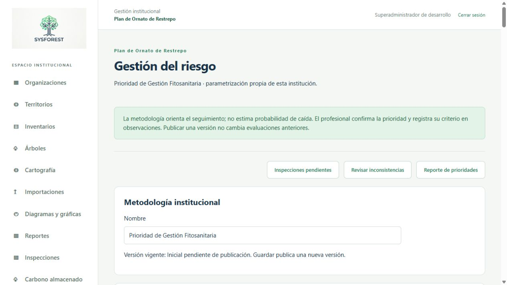

La prioridad orienta la gestión fitosanitaria y requiere criterio profesional. La captura de ejemplo muestra una versión inicial pendiente de publicación; no acredita una metodología aprobada.

1. Aviso de alcance: la prioridad no estima la probabilidad de caída.
2. Inspecciones pendientes y Revisar inconsistencias: orientan la revisión profesional.
3. Versión vigente: comprueba qué metodología está publicada antes de usar sus resultados.

## 20 Guías rápidas incidencias y glosario

### Tres recorridos de trabajo

- Nueva jornada de campo: iniciar sesión → seleccionar institución → comprobar campaña activa → buscar el individuo → registrar árbol si realmente es nuevo → crear inspección → adjuntar evidencias → revisar fichas guardadas.
- Seguimiento de un árbol: localizar su código → revisar última visita e historial → registrar nueva inspección → cambiar explícitamente estado o ubicación si corresponde → crear y seguir una orden de mantenimiento cuando se decida intervenir.
- Entrega de resultados: seleccionar alcance y filtros → comprobar totales y advertencias → revisar tabla → descargar el formato disponible → conservar el archivo junto con sus criterios y fecha de consulta.

### Resolver problemas frecuentes

| Situación | Acción recomendada |
| --- | --- |
| No hay organizaciones o campañas disponibles | Comprueba membresía, rol, institución y estado de campaña. Solicita al administrador la habilitación que corresponda. |
| Un selector no encuentra la especie | Busca nombre científico y nombres alternativos; verifica referencias activas. No inventes una especie para guardar. |
| El mapa muestra menos puntos que el total | Revisa Sin ubicación, encuadre y modo de agrupación. El total puede incluir individuos sin coordenadas. |
| No aparece una fotografía o registro en el portal | Revisa toda la cadena de publicación, autorizaciones individuales, estado del propietario y ausencia de anulación. |
| El archivo Excel tiene errores | Revisa fila y columna indicadas, catálogos y formato. Corrige y carga un nuevo lote; no cambies los encabezados ni la estructura y no agregues fórmulas. |
| Conflicto al guardar (409) | Conserva tus observaciones, abre la versión vigente y compara. Otra persona pudo modificar el registro. No insistas con la misma pestaña obsoleta. |
| Acceso denegado (403) o no encontrado (404) | Comprueba cuenta, permisos y contexto. Un enlace puede pertenecer a otra institución o a un recurso no disponible. |
| Datos no válidos (422) | Corrige los campos señalados y vuelve a revisar los valores. Un filtro contradictorio también puede impedir la consulta. |
| Demasiadas solicitudes (429) | Espera el intervalo indicado antes de reintentar; evita pulsaciones repetidas. |
| Servicio no disponible o conexión interrumpida | Conserva el formulario, revisa la conexión y comunica el módulo y hora al administrador. Antes de reenviar una escritura, verifica si ya quedó registrada. |

### Glosario de consulta

- Ámbito: conjunto de instituciones o territorio que tu cuenta puede consultar. No concede por sí mismo permiso para editar.
- Catálogo: lista administrada de referencias válidas. Un selector utiliza estas referencias para evitar variaciones libres de escritura.
- CAP: circunferencia registrada a la altura de referencia del instrumento, expresada en centímetros. DAP: diámetro derivado de los datos de la inspección.
- Evidencia: fotografía con propietario, tipo, descripción e historial propios.
- Número legado: identificador de una fuente anterior; se conserva separado del código permanente SysForest.
- Última inspección: visita seleccionada por fecha y orden estable; una corrección posterior no convierte automáticamente una visita antigua en la más reciente.
- Anulación: retiro funcional de un registro creado por error, conservando identidad e historial. No es equivalente a la muerte del árbol.
- UTC: referencia horaria utilizada explícitamente en auditoría y fotografías. La captura de ubicación del árbol muestra hora de Colombia.
- GeoJSON: archivo de geometrías geográficas. En las capas locales se utiliza WGS84 y el orden longitud, latitud.

Para reportar una incidencia incluye módulo, código visible del registro, organización, fecha y hora, acción intentada y mensaje mostrado. Evita enviar contraseñas, enlaces de recuperación o archivos privados por canales no autorizados. Describe si el problema ocurrió antes o después de pulsar Guardar; esa diferencia ayuda a verificar el resultado sin duplicar trabajo.

### Entrar a SysForest Mobile

Abre SysForest en el teléfono con conexión a internet. La pantalla solicita Correo electrónico y Contraseña; la dirección de la plataforma viene incluida en la aplicación y no necesitas escribir un código de institución.

1. Escribe el correo de tu cuenta y su contraseña; pulsa Continuar.

1. Si tienes acceso a una sola institución, la aplicación entra automáticamente. Si tienes varias, selecciona el nombre de la institución donde vas a trabajar y pulsa Ingresar. Ninguna opción queda elegida de antemano.

1. Comprueba la cuenta y la institución antes de descargar inventarios o registrar datos. Para corregir el correo mientras se muestra la lista, utiliza Cambiar cuenta: se borra la contraseña y debes escribirla otra vez.

La lista se obtiene después de comprobar tu contraseña. Si no aparecen instituciones, solicita al administrador que revise el acceso de tu cuenta. Si las credenciales no son aceptadas, revisa el correo y la contraseña; la aplicación no permite consultar instituciones indicando únicamente un correo.

Cuando se necesita iniciar sesión de nuevo para sincronizar trabajo guardado, la cuenta y la institución permanecen fijas: escribe la contraseña de esa cuenta. Los árboles, visitas y fotografías pendientes conservan su autor y su institución. El primer ingreso no se puede realizar sin internet; la consulta offline requiere datos descargados previamente.

Si la aplicación informa que la plataforma no está configurada o que cambió respecto de tu cuenta guardada, comunica el aviso al administrador. La consulta local sigue disponible y los pendientes se conservan; la conexión se bloquea hasta disponer de una configuración compatible. No borres los datos de la aplicación para resolver ese aviso.

### Actualizar la app para usar producción

SysForest Mobile 0.2.1+3 incorpora https://sysforest.varcor.tech. Una vez habilitado el dominio con HTTPS válido, la conexión utiliza internet y no requiere cable USB ni que el computador local esté encendido. El APK se instala como actualización sobre la versión anterior cuando conserva la misma firma. No desinstales la app ni borres sus datos.

Antes de actualizar, revisa si tienes capturas, visitas o fotos pendientes de la plataforma local y coordina su envío y traslado con el administrador. El servidor local y producción son instalaciones independientes: los cambios posteriores a la copia no se transfieren automáticamente.

Si al abrir la versión nueva aparece el aviso de otra plataforma, los datos locales siguen conservados. Para entrar a producción, abre el menú de cuenta, pulsa Cerrar sesión y vuelve a escribir tu correo y contraseña. Si hay varias instituciones, elige la que corresponda. Cerrar sesión conserva los pendientes de la cuenta anterior, pero no los traslada ni los envía al servidor nuevo.

Los pendientes de la plataforma local solo pueden enviarse usando una configuración y un servidor compatibles con su cuenta original. Solicita asistencia para resolverlos; no vuelvas a crear esos árboles en producción como solución al aviso. La compilación del APK no acredita por sí sola una prueba en un teléfono físico o en iPhone.

### Trabajo móvil y revisión posterior

Prepara la cuenta, el inventario y los catálogos con conexión. Durante el trabajo de campo conserva las capturas, visitas y fotografías en la misma cuenta e institución. Al reconectar revisa pendientes, rechazos y conflictos; reenviar una operación con su mismo identificador permite recuperar su confirmación sin duplicar el árbol.

Riesgo y carbono son resultados del servidor y pueden no estar disponibles antes de sincronizar. La app debe distinguir un resultado pendiente o antiguo de una confirmación actual. La validación profesional de prioridad se realiza según el flujo web documentado. Un conflicto de versión requiere comparar los cambios antes de reintentar; no lo soluciones creando otro árbol.

Al confirmar una visita nueva, SysForest Mobile intenta consultar sus resultados para mostrar prioridad, avisos y carbono con la procedencia de la referencia. Si el servidor es anterior o no concede acceso a riesgo, la app permite trabajar sin esos campos. Una visita pendiente de sincronizar muestra sus resultados como pendientes de actualización. Al descargar de nuevo el detalle se actualizan los resultados; mientras tanto, una copia local puede estar desactualizada.
