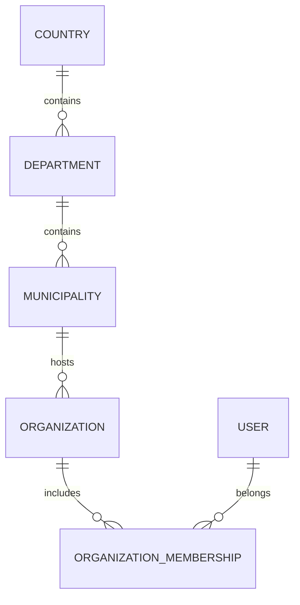

# Fase 3 — Territorios, organizaciones y fundamento multi-tenant

Fecha de verificación: **12 de septiembre de 2026**. Proyecto definitivo: **/home/josev/SYSFOREST**, Ubuntu-24.04 WSL. Estado: **implementada y verificada; pendiente de revisión del usuario antes de Fase 4**.

Se preservó la infraestructura aprobada. No se reconstruyó Laravel ni se modificaron Dockerfile, docker-compose.yml, Nginx, PostgreSQL, PHP-FPM, Redis o sus secretos. No se implementaron módulos forestales, JWT ni roles finales.

## Checkpoint y secuencia

Antes de modificar código se inspeccionó Git, se verificaron los seis servicios saludables y se ejecutaron las pruebas existentes: 11 aprobadas, 48 aserciones y dos integraciones omitidas por la configuración anterior. No había una dependencia de ejecución hacia phase2-staging.

Se creó el checkpoint **f846b38**, mensaje `feat: complete phase 2 docker infrastructure`, y la rama **codex/phase-3**. El esquema se presentó antes de ejecutar la migración. Todos los cambios definitivos están en el proyecto WSL; los archivos temporales de transporte de parches de Windows no son una copia ejecutable ni fuente del proyecto.

## A. Esquema final

Todas las tablas nuevas usan UUID independientes de los códigos humanos. Los timestamps son `timestamp with time zone`.

| Tabla | Campos principales | Integridad e índices |
| --- | --- | --- |
| countries | id UUID, code varchar(12), name varchar(150), iso_alpha_2 char(2) nullable, iso_alpha_3 char(3) nullable, active boolean, created_at, updated_at | PK UUID; únicos code y cada ISO. |
| departments | id UUID, country_id UUID obligatorio, code varchar(12), name varchar(150), geometry nullable, active boolean, timestamps | FK restrict a countries; UNIQUE(country_id, code); geometry(MultiPolygon,4326), GiST y CHECK ST_IsValid. |
| municipalities | id UUID, department_id UUID obligatorio, code varchar(12), name varchar(150), geometry nullable, active boolean, timestamps | FK restrict a departments; UNIQUE(department_id, code); geometry(MultiPolygon,4326), GiST y CHECK ST_IsValid. |
| organizations | id UUID, municipality_id UUID obligatorio, type varchar(30), name varchar(200), short_name varchar(80) nullable, code varchar(40), tree_code_prefix varchar(60), email varchar(255) nullable, phone varchar(40) nullable, logo_path varchar(500) nullable, settings JSONB default {}, active boolean, timestamps, deleted_at nullable | FK restrict a municipalities; únicos code y tree_code_prefix; índice(municipality_id, active); CHECK de tipo, objeto JSONB y formato de códigos. |
| organization_memberships | id UUID, user_id BIGINT obligatorio, organization_id UUID obligatorio, active boolean, joined_at y left_at nullable, timestamps | FK restrict a users y organizations; UNIQUE(user_id, organization_id); UNIQUE(organization_id,id); índice(organization_id,active); CHECK de fechas. |

Se conserva el BIGINT existente de `users.id` para no reconstruir cuentas de Fase 2. No se añadió `users.organization_id`. Los cinco modelos nuevos utilizan `HasUuids` de Laravel.

`OrganizationType` contiene exactamente `school`, `municipality`, `department_entity`, `national_entity` y `other`. Ser una entidad nacional o departamental no elimina el municipio obligatorio ni concede permisos.

SoftDeletes se aplica a organizaciones anuladas por error. Los códigos siguen reservados tras la anulación. Las membresías se desactivan/reactivan conservando identidad; los territorios son catálogos compartidos con estado activo y referencias restringidas.

## B. Relaciones



Los modelos exponen relaciones en ambos sentidos. `User::organizations()` y `Organization::users()` reutilizan organization_memberships y sus campos de pertenencia. La UI recibe la cadena `organization.municipality.department.country` precargada.

## C. Migraciones

Se añadió únicamente:

`database/migrations/2026_09_12_000001_create_territorial_foundation.php`

La migración se aplicó de forma incremental, con el rol migrador, a las bases operativa y de pruebas:

```bash
docker compose run --rm init
```

Resultado inicial: DONE en ambas bases, 87.88 ms y 71.66 ms. No se ejecutó `migrate:fresh`.

Se comprobó que `sysforest_testing` tenía cero países, organizaciones y membresías, y que la migración nueva era el único elemento del lote 2. Después se verificó exclusivamente allí:

```bash
docker compose run --rm --no-deps -e DB_DATABASE=sysforest_testing init php artisan migrate:rollback --step=1 --path=database/migrations/2026_09_12_000001_create_territorial_foundation.php --force
docker compose run --rm --no-deps -e DB_DATABASE=sysforest_testing init php artisan migrate --force
```

Resultados: rollback DONE en 20.02 ms; reaplicación DONE en 59.08 ms. El rollback elimina en orden inverso las cinco tablas nuevas y conserva PostGIS y el esquema previo. La base operativa y el piloto permanecieron intactos.

Estos comandos de rollback son evidencia de la comprobación realizada sobre una base vacía de pruebas; no son pasos de arranque normal.

## D. Models

Nuevos: `Country`, `Department`, `Municipality`, `Organization`, `OrganizationMembership`.

Modificado: `User`, para relaciones múltiples sin alterar su clave existente.

Incluyen relaciones tipadas y casts de estado, enum, settings y fechas. Los campos de geometría no admiten mass assignment. `settings` y `logo_path` quedan preparados en el esquema pero fuera de los formularios y del fillable de Organization, pendientes de casos de uso propios.

## E. Controllers

| Controller | Coordinación HTTP |
| --- | --- |
| OrganizationController | Listado propio, formulario de creación, alta, detalle, edición y actualización. |
| TerritoryController | Vista de jerarquía territorial preparada por el Service. |
| TenantSelectionController | Selección validada de organización y almacenamiento en sesión. |
| OrganizationMembershipController | Lectura y cambio de estado de membresía mediante Service; respuestas JSON mínimas. |
| LocalAccessController | Información, consumo del enlace técnico y cierre de la sesión de revisión. |

No contienen consultas Eloquent ni reglas institucionales. `SystemStatusController` conserva la infraestructura de Fase 2.

## F. Services

| Service | Caso de uso |
| --- | --- |
| TerritoryService | Catálogo, municipios seleccionables, validación de jerarquía activa y geometría territorial autorizada. |
| OrganizationService | Crear organización y primera membresía en una transacción; actualización autorizada; lecturas propias/departamentales/nacionales explícitas. |
| OrganizationMembershipService | Consulta, incorporación y activación/desactivación dentro del contexto. |
| TenantContextService | Resolución, revalidación y limpieza del tenant. |
| PilotSeedService | Seeds reproducibles de la jerarquía y del piloto. |
| LocalAccessService | Emisión exclusiva de consola local y consumo atómico del acceso técnico temporal. |

Las operaciones que afectan varias tablas utilizan transacciones. Las mutaciones de tenant revalidan la membresía del actor y solicitan bloqueo de fila dentro de la transacción. Un conflicto concurrente de código/prefijo único se traduce en error de validación controlado.

## G. Repositories

Nuevos: `CountryRepository`, `DepartmentRepository`, `MunicipalityRepository`, `OrganizationRepository`, `OrganizationMembershipRepository`, `UserRepository`.

Concentran consultas, precarga de relaciones y persistencia. No se añadieron interfaces vacías. La búsqueda de una membresía operativa combina tenant e ID en la misma consulta. Las consultas espaciales usan parámetros SQL y SRID explícito. Las consultas administrativas tienen métodos independientes y autorización previa en el Service.

## H. Requests y validación

- `StoreOrganizationRequest`.
- `UpdateOrganizationRequest`.
- `SwitchOrganizationRequest`.
- `UpdateMembershipRequest`.

`OrganizationRules` comparte reglas y mensajes entre Form Requests y Services. `ActiveMunicipality` valida municipio y padres activos mediante el servicio territorial; `UniqueOrganizationValue` consulta únicamente columnas permitidas.

Se validan nombre, tipo, correo, municipio UUID existente, códigos/prefijo, longitudes y estado. Los códigos se normalizan a mayúsculas en el formulario. Las modificaciones prohíben reasignar identidad, usuario, organization_id, settings, logo y campos de auditoría. Las rutas de recursos validan UUID antes de consultar PostgreSQL. Las vistas muestran errores de validación en español.

## I. TenantContext

`TenantContext` está registrado como scoped, almacena actor y organización verificados y falla cerrado si no hay contexto. `TenantContextService` comprueba pertenencia activa y organización vigente, y detecta una revocación posterior a la activación.

La sesión contiene solo la selección; no acredita autorización. `ResolveTenantContext` verifica esa selección en cada petición y limpia mediante finally. `LoadLocalAccessGrant` delimita la capacidad técnica local y limpia ambos contextos. `UseTenantContext` reconstruye el contexto de jobs y lo elimina incluso ante excepciones o un actor inexistente.

`OrganizationPolicy` y `OrganizationMembershipPolicy` separan pertenencia de permiso de gestión. No existe un global scope de tenant. Las lecturas nacional/departamental están denegadas por defecto; los tests conceden únicamente permisos explícitos para comprobar su funcionamiento.

El contrato completo y el patrón futuro de FK compuesta están en [multitenancy.md](multitenancy.md). La clave `UNIQUE(organization_id,id)` de memberships prepara referencias que deberán incorporar ambas columnas para impedir asociaciones cruzadas.

## J. Seeders

`TerritorySeeder` y `PilotOrganizationSeeder`, coordinados por `DatabaseSeeder`, utilizan `PilotSeedService` y repositorios con upsert por códigos estables.

```bash
docker compose exec app php artisan db:seed --force
```

Se ejecutó más de una vez: terminó correctamente, mantuvo los UUID y produjo una sola organización piloto. No crea usuarios, árboles ni polígonos. No restaura automáticamente una organización que haya sido anulada con SoftDeletes. Es un seed de referencia: al repetirlo actualiza los atributos definidos del piloto.

Códigos respaldados por fuentes primarias:

- Colombia: M49 **170**, ISO **CO/COL**, [Naciones Unidas, M49](https://unstats.un.org/unsd/methodology/m49/overview).
- Meta: **50**; Villavicencio: **50001**, [DANE, ficha municipal CNPV](https://sitios.dane.gov.co/cnpv/app/views/informacion/fichas/50001.pdf).
- `INEM-VVC` y `COL-MET-VVC-INEM` son identificadores internos del piloto; no se presentan como códigos oficiales.

## K. Vistas Blade y revisión visual

Se crearon:

- Layout institucional, navegación y paginación reutilizables.
- Componentes de campo y resumen de errores.
- Organizaciones: listado, detalle, crear, editar y parcial común de formulario.
- Territorios: jerarquía país/departamento/municipio.
- Página informativa de acceso técnico.

La portada técnica conserva los diagnósticos e incorpora un enlace a Fase 3. Se reutiliza el logotipo original. Los datos relacionados se cargan antes de renderizar; un test activa la prohibición de lazy loading para las pantallas del piloto.

El selector utiliza **Select2 4.0.13 + jQuery 3.7.1**, almacenados localmente con licencias y SHA-256 en `public/vendor/manifest.json`. El JavaScript solo mejora la presentación del select: la validación y autorización permanecen en PHP. El formulario conserva el select nativo si JavaScript no se carga. Fuentes: [instalación oficial de Select2](https://select2.org/getting-started/installation/), [release oficial de jQuery](https://blog.jquery.com/2023/08/28/jquery-3-7-1-released-reliable-table-row-dimensions/).

Se verificó en navegador real:

- Listado con el piloto, apertura del detalle y cadena territorial completa.
- Formulario nuevo y edición con valores precargados.
- Búsqueda de Villavicencio en Select2.
- Formulario y catálogo a viewport móvil de 390 × 844; ancho de contenido igual al viewport disponible, sin desbordamiento horizontal.
- Ausencia de errores/advertencias de JavaScript durante la revisión.

Las altas/ediciones exitosas y sus errores se verifican por Feature tests sobre la base de pruebas; no se crearon organizaciones ficticias en la base operativa.

### Acceso para revisión

Se preparó explícitamente la cuenta técnica local `phase3.local@sysforest.test`, vinculada al piloto. No es un seeder de usuario ni una cuenta con roles definitivos. Tiene contraseña aleatoria no publicada y carece de un login por contraseña en esta fase.

Emitir un nuevo enlace:

```bash
docker compose exec app php artisan sysforest:local-access phase3.local@sysforest.test --organization=INEM-VVC
```

El enlace requiere APP_ENV local y emisión desde Artisan; dura 10 minutos, es firmado y de uso único. Se almacena bajo hash y se consume con bloqueo de caché Redis. La sesión técnica dura 30 minutos y exige actor coincidente. La pertenencia se revalida al consumir el enlace y al operar en el tenant. Los formularios mantienen protección CSRF.

Los flags `--create-user --join` sirven solo para una preparación local explícita de la cuenta y membresía. La sesión de revisión concede gestión técnica de las organizaciones autorizadas del actor; no acceso nacional/departamental. El mecanismo está deshabilitado fuera de local y debe retirarse al integrar autenticación final.

## L. Tests añadidos

| Archivo | Cobertura |
| --- | --- |
| tests/Unit/TenantContextTest.php | Contexto obligatorio, limpieza e independencia de instancias. |
| tests/Feature/TerritorialFoundationTest.php | UUID, relaciones, seeds, unicidad, municipio obligatorio, enum, membresías múltiples y sus estados. |
| tests/Feature/TerritorySpatialTest.php | Persistencia/recuperación de MultiPolygon, consulta espacial, SRID e índices GiST reales. |
| tests/Feature/TenantIsolationTest.php | IDOR por HTTP y Service/Repository, sesión manipulada, contexto ajeno, revocación, jobs, lecturas administrativas y selección explícita. |
| tests/Feature/OrganizationHttpTest.php | Vistas con relaciones precargadas, altas/ediciones, validaciones, transacciones y creación inactiva. |
| tests/Feature/LocalAccessTest.php | Firma, uso único, flags explícitos, expiración, revocación y prohibición fuera de local. |

Se añadió `tests/PostgresTestCase.php`: exige entorno testing, driver pgsql y nombre de base de pruebas antes de cualquier fixture. Utiliza transacciones reversibles. No usa RefreshDatabase ni SQLite.

## M. Total de pruebas y aserciones

**78 tests aprobados, 255 aserciones; cero fallos y cero omisiones.** Incluye los 13 tests existentes de Fase 2, ahora con sus dos integraciones activadas, y 65 casos nuevos de Fase 3.

```bash
docker compose exec app php artisan test --compact --fail-on-warning
```

La suite completa pasó también después de revertir/reaplicar la migración de prueba. Duración observada: aproximadamente 3 segundos.

Se corrigió una incidencia de precedencia de entorno: las variables Docker presentes en `$_SERVER` prevalecían sobre las entradas `env` de PHPUnit. La protección de PostgresTestCase rechazó esa configuración antes de modificar la base operativa. `phpunit.xml` ahora fija tanto `env` como `server`, con force, para testing/pgsql/sysforest_testing, y activa las integraciones. Si cambia DB_TEST_DATABASE, deben actualizarse ambas entradas DB_DATABASE.

## N. PSR-12

Se ejecutó el formatter solicitado:

```bash
docker run --rm --user 1000:1000 --volume /home/josev/SYSFOREST:/var/www/html --workdir /var/www/html --entrypoint composer sysforest-app:local format
docker compose exec app composer lint
```

Resultado: **PASS, 86 archivos PHP**. El formatter inicial corrigió ocho incidencias de estilo. Los comentarios y PHPDoc propios están en español y documentan límites, integridad, seguridad y decisiones; no se añadieron comentarios obvios por línea.

## O. Prueba PostGIS

PostgreSQL operativo: **17.5**. PostGIS: **3.5.2**. Las dos entradas de `geometry_columns` son:

| Tabla | Tipo | SRID |
| --- | --- | --- |
| departments | MULTIPOLYGON | 4326 |
| municipalities | MULTIPOLYGON | 4326 |

La prueba persistió y recuperó en sysforest_testing:

```text
MULTIPOLYGON(((-73.7 4.1,-73.6 4.1,-73.6 4.2,-73.7 4.2,-73.7 4.1)))
```

Comprobó WKT y SRID, y ejecutó `ST_Covers` con un punto interior (-73.65,4.15) y uno exterior (-70,0). El primero devuelve el municipio y el segundo no. También comprueba ambos índices GiST. La geometría artificial se revierte con la transacción; el piloto operativo conserva geometrías NULL.

## P. Evidencia de aislamiento

Las pruebas crean dos usuarios, organizaciones A/B y membresías reales en PostgreSQL/PostGIS:

| Intento desde A | Resultado comprobado |
| --- | --- |
| Activar B sin pertenencia | AuthorizationException / HTTP 403; contexto limpio. |
| Resolver membresía de B por Repository | ModelNotFoundException. |
| Consultar organización o membresía B por HTTP | HTTP 404. |
| Modificar organización B o desactivar su membresía | HTTP 404 y datos de B intactos, aun concediendo gestión a A. |
| Inyectar organization_id en actualización | HTTP 422; identidad sin cambio. |
| Usar sesión o actor ajenos | HTTP 403 / excepción de autorización. |
| Operar tras revocar la membresía o anular/inactivar la organización | Acceso denegado. |
| Usar lectura nacional para modificar B | Acceso operativo ajeno denegado. |
| Lectura departamental expresamente autorizada | Solo organizaciones adscritas al departamento solicitado. |
| Fallar un job o resolver un actor inexistente | Contexto limpiado en finally. |

Un único User pertenece a A y B. Desactivar su membresía A no desactiva la cuenta ni la membresía B. La reactivación reutiliza el ID de la relación. La pertenencia sola no concede gestión.

Una revisión independiente de solo lectura no encontró fallos concretos de autorización o aislamiento que requirieran corrección dentro de esta fase. Las pruebas se mantienen como evidencia reproducible; no equivalen a una auditoría final de producción.

## Q. Registro seed del piloto

Consulta real tras repetir los seeders:

| Campo | Valor |
| --- | --- |
| id | 01a0967f-0b10-73ea-8e2c-2029d1000d70 |
| name | Institucion Educativa INEM Luis Lopez de Mesa |
| type | school |
| code | INEM-VVC |
| tree_code_prefix | COL-MET-VVC-INEM |
| municipality | Villavicencio |
| department | Meta |
| country | Colombia |
| total organizations | 1 |

Este UUID corresponde a esta instalación. Una instalación nueva genera su propio UUID; repetir el seeder en la misma instalación lo conserva.

## R. Incidencias, límites y decisiones pendientes

Resueltos: precedencia PHPUnit/Docker, estilos PSR-12, limpieza del contexto incluso si el actor de un job no existe y redirección de una creación inactiva al listado sin sustituir el contexto vigente.

Decisiones reservadas para fases posteriores:

- Fase 4: autenticación definitiva, JWT access en cookie HttpOnly, refresh opaco/rotatorio/revocable, roles y permisos por membresía; sustituir el adaptador local. No se creó una FK de rol sin modelo ni reglas aprobadas.
- Mantener User BIGINT evita una migración invasiva de cuentas de Fase 2; cualquier conversión futura deberá planificarse expresamente.
- La auditoría completa y actor created_by/updated_by se integrarán en los Services/transacciones. Ningún formulario puede falsificar esos campos.
- Reactivación/restauración institucional, logo y edición de settings requieren sus casos de uso autorizados. El listado actual muestra únicamente organizaciones activas de la cuenta.
- Catálogos completos y polígonos oficiales requieren una carga territorial con procedencia confirmada. Los campos e índices ya están preparados.
- No existe RLS de PostgreSQL ni un scope global implícito: la estrategia implementada es explícita por capas, Policies, filtros y constraints. Los módulos futuros deberán respetar el contrato y añadir sus pruebas.
- Árboles, inspecciones, inventarios, reportes, importaciones, mapa Leaflet y catálogos forestales no pertenecen a esta fase.

### Infraestructura conservada

| Servicio / contenedor | Estado al cierre | Puerto publicado |
| --- | --- | --- |
| app / sysforest-app-1 | healthy | ninguno; FPM interno 9000 |
| nginx / sysforest-nginx-1 | healthy | 127.0.0.1:8080 → 80 |
| postgres / sysforest-postgres-1 | healthy | ninguno; interno 5432 |
| redis / sysforest-redis-1 | healthy | ninguno; interno 6379 |
| queue / sysforest-queue-1 | healthy | ninguno |
| scheduler / sysforest-scheduler-1 | healthy | ninguno |

PHP **8.4.25**, Laravel **13.31.0**, Redis responde **PONG**. Queue y scheduler se recargaron para incorporar las clases. El worker procesó InfrastructureProbeJob el 12/09/2026 a las 17:00:58 UTC; el scheduler ejecutó sysforest:probe-scheduler a las 17:01 y 17:02 UTC. Los inicializadores db-init/init completaron su función con éxito.

## S. Git status

Rama: **codex/phase-3**. HEAD: **f846b38**, checkpoint de Fase 2. Los cambios de Fase 3 quedan sin commit para revisión: **10 archivos modificados y 72 nuevos**. No se borraron archivos del proyecto.

```text
 M AGENTS.md
 M CLAUDE.md
 M README.md
 M app/Models/User.php
 M app/Providers/AppServiceProvider.php
 M bootstrap/app.php
 M database/seeders/DatabaseSeeder.php
 M phpunit.xml
 M resources/views/system-status.blade.php
 M routes/web.php
?? app/Console/Commands/LocalAccessCommand.php
?? app/Enums/OrganizationType.php
?? app/Http/Controllers/LocalAccessController.php
?? app/Http/Controllers/OrganizationController.php
?? app/Http/Controllers/OrganizationMembershipController.php
?? app/Http/Controllers/TenantSelectionController.php
?? app/Http/Controllers/TerritoryController.php
?? app/Http/Middleware/LoadLocalAccessGrant.php
?? app/Http/Middleware/ResolveTenantContext.php
?? app/Http/Requests/StoreOrganizationRequest.php
?? app/Http/Requests/SwitchOrganizationRequest.php
?? app/Http/Requests/UpdateMembershipRequest.php
?? app/Http/Requests/UpdateOrganizationRequest.php
?? app/Jobs/Middleware/UseTenantContext.php
?? app/Models/Country.php
?? app/Models/Department.php
?? app/Models/Municipality.php
?? app/Models/Organization.php
?? app/Models/OrganizationMembership.php
?? app/Policies/OrganizationMembershipPolicy.php
?? app/Policies/OrganizationPolicy.php
?? app/Repositories/CountryRepository.php
?? app/Repositories/DepartmentRepository.php
?? app/Repositories/MunicipalityRepository.php
?? app/Repositories/OrganizationMembershipRepository.php
?? app/Repositories/OrganizationRepository.php
?? app/Repositories/UserRepository.php
?? app/Rules/ActiveMunicipality.php
?? app/Rules/UniqueOrganizationValue.php
?? app/Services/LocalAccessService.php
?? app/Services/OrganizationMembershipService.php
?? app/Services/OrganizationService.php
?? app/Services/PilotSeedService.php
?? app/Services/TenantContextService.php
?? app/Services/TerritoryService.php
?? app/Tenancy/LocalAccessContext.php
?? app/Tenancy/TenantContext.php
?? app/Validation/OrganizationRules.php
?? database/migrations/2026_09_12_000001_create_territorial_foundation.php
?? database/seeders/PilotOrganizationSeeder.php
?? database/seeders/TerritorySeeder.php
?? docs/multitenancy.md
?? public/css/institutional.css
?? public/css/municipality-select.css
?? public/js/municipality-select.js
?? public/vendor/jquery/LICENSE.txt
?? public/vendor/jquery/jquery.min.js
?? public/vendor/manifest.json
?? public/vendor/select2/LICENSE.md
?? public/vendor/select2/es.js
?? public/vendor/select2/select2.min.css
?? public/vendor/select2/select2.min.js
?? resources/views/components/field.blade.php
?? resources/views/components/form-errors.blade.php
?? resources/views/layouts/institutional.blade.php
?? resources/views/organizations/create.blade.php
?? resources/views/organizations/edit.blade.php
?? resources/views/organizations/index.blade.php
?? resources/views/organizations/partials/form.blade.php
?? resources/views/organizations/show.blade.php
?? resources/views/partials/institutional-navigation.blade.php
?? resources/views/partials/pagination.blade.php
?? resources/views/phase3/access.blade.php
?? resources/views/territories/index.blade.php
?? tests/Feature/LocalAccessTest.php
?? tests/Feature/OrganizationHttpTest.php
?? tests/Feature/TenantIsolationTest.php
?? tests/Feature/TerritorialFoundationTest.php
?? tests/Feature/TerritorySpatialTest.php
?? tests/PostgresTestCase.php
?? tests/Unit/TenantContextTest.php
?? docs/phase-3.md
```

## T. Archivos creados y modificados

El inventario completo de S identifica individualmente cada archivo: `M` significa modificado y `??` nuevo sin seguimiento. Todos son relativos a **/home/josev/SYSFOREST**.

Se modificaron las instrucciones de continuidad AGENTS/CLAUDE, README, User, AppServiceProvider, bootstrap/app.php, DatabaseSeeder, phpunit.xml, la portada técnica y las rutas. Se añadieron las capas territoriales/institucionales, seguridad de contexto, una migración, seeders, interfaz y assets locales, tests y documentación.

No se modificaron Dockerfile, docker-compose.yml, composer.json, composer.lock, configuración de infraestructura ni secretos.

**La Fase 4 no está iniciada.**
